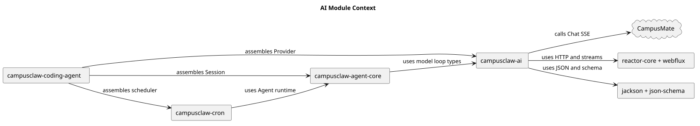
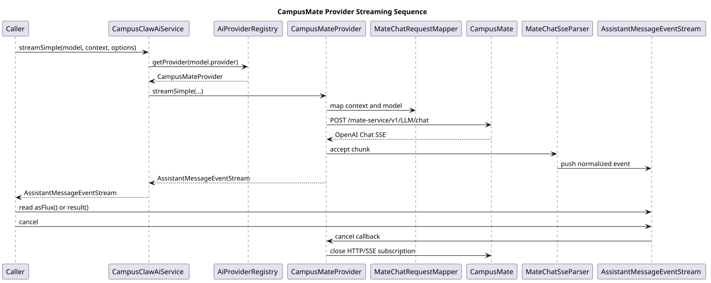
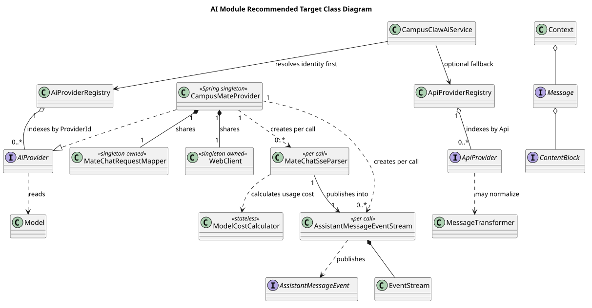

# AI 模块设计

| 属性 | 值 |
|---|---|
| 文档版本 | 2.0.0 |
| 状态 | Implemented |
| 更新日期 | 2026-09-15 |
| 实施起点 | `29ebec6a8cad99896414211cda28c6fffec71bee` |
| 已批准设计 | `pi-mono-java-design@0a74625e0dd4ea6387b6765c7cb0f9105970d05c`，`02-服务与接口/03-模型管理Provider契约/README.md` 2.7.0 |
| Java 设计基线 | `f61906b9` |
| pi 参考基线 | `5cd93f688aaab89dbb6dfa4aca535f21796ae185` |
| 决策记录 | [ADR-0109](../decisions/0109-use-campusmate-only-provider.md) |

## 1. 职责与边界

`campusclaw-ai` 提供统一消息、工具、模型、流式事件、Provider SPI 和内存模型注册表。
产品默认只装配 `CampusMateProvider`，其稳定身份为 `campusmate`。该 Provider 使用独立
`WebClient` 调用 CampusMate Chat，不持有第三方模型端点或凭据。

模块继续保留两组扩展接口：

- `AiProvider` / `AiProviderRegistry` 按稳定 `ProviderId` 路由；
- `ApiProvider` / `ApiProviderRegistry` 按协议路由，供显式的自定义适配器注册、查询、注销和清理。

默认 `ApiProviderRegistry` 允许为空。模型调用先按 Provider 身份查找；未命中时才按
`Model.api` 查找自定义 API 适配器。两处都未命中时明确抛错，不发起网络请求，也不自动转到
CampusMate。

[PlantUML 源码](./ai/diagram.puml#L1)

## 2. Provider 身份与路由

### 2.1 当前身份

| 项目 | 当前值 |
|---|---|
| Java 类 | `com.campusclaw.ai.provider.mate.CampusMateProvider` |
| Provider ID | `campusmate` |
| `Provider` 枚举 | `CAMPUSMATE` |
| 内部 API | `openai-completions` |
| HTTP operation | `POST /mate-service/v1/LLM/chat` |
| 默认认证 | `ProviderAuth.none()` |

身份切换是一次性架构变化。代码不注册 `mate-model-manager` 别名，不提供旧枚举解析、旧类转发、
SQL 或 JSONL 迁移。历史 Assistant `_provider` 字符串按原值读取和写回；模型身份比较仍同时比较
Provider 与模型 ID，因此旧值不会与 `campusmate` 被视为同一模型。

`Provider` 和 `Api` 中其余枚举值仍是公共消息与扩展数据契约，不表示产品默认装配了对应的
HTTP 适配器。

### 2.2 路由顺序

`CampusClawAiService.stream/streamSimple` 依次执行：

1. 从 `Model.provider().value()` 构造 `ProviderId`，查询 `AiProviderRegistry`；
2. 命中后直接调用该 `AiProvider`；
3. 未命中时按 `Model.api()` 查询 `ApiProviderRegistry`；
4. 仍未命中时抛出 `IllegalArgumentException`。

该顺序让 CampusMate 模型不会被同为 `openai-completions` 的自定义 API 适配器截获，同时保留
显式扩展能力。

[PlantUML 源码](./ai/diagram.puml#L30)

## 3. CampusMate Chat 适配

`CampusMateProvider` 保留既有请求、SSE、错误和取消语义：

- `MateChatRequestMapper` 把 system、User、Assistant、ToolResult、Tool 定义和
  `SimpleStreamOptions` 映射为 OpenAI Chat 风格 JSON；
- 请求固定 `stream=true` 和 `stream_options.include_usage=true`；
- `MateChatSseParser` 解析文本、ToolCall、reasoning 签名、finish reason 和 Usage；
- `MateReasoningSignature` 保留 reasoning 字段名，以便下一轮重放；
- 调用方取消时关闭 Reactor HTTP/SSE subscription，并把终态收敛为 `StopReason.ABORTED`；
- 禁用 HTTP 自动重试，不重放结果未知的创建请求；
- 图片等不支持内容在创建 HTTP 请求前失败；
- 上游错误只投影稳定错误码，`MATE_MODEL_MANAGER_ERROR` 等既有错误码保持不变。

配置键 `campusmate.*`、Chat path 和内部 API 字符串 `openai-completions` 不随 Provider 身份改名。
共享配置与精确 HTTP 边界见
[CampusMate 客户端共享配置](campusmate-shared-config.md)和
[CampusMate Chat Provider](model-manager-chat-v2.md)。

## 4. 模型目录

`ModelRegistry` 继续按 `(Provider, modelId)` 提供注册、批量注册、查询、按 Provider 清理、全量
清理、成本计算、模型身份比较和 xhigh 能力判断。

启动加载顺序固定为：

1. 可选 classpath `/campusclaw-models.json`；
2. 可选用户文件 `~/.campusclaw/agent/models.json`。

后加载的用户文件覆盖相同身份的 classpath 定义。没有外部 JSON 时目录为空；代码不再内置任何
Anthropic、OpenAI、Mistral 或其他第三方模型，也不虚构 CampusMate 模型。

Runtime 模型不依赖这个默认目录。`MateRuntimeModelManager` 从同一受管 Agent 目录快照读取
`defaultModelId/enabledModelIds`，按请求时选定的 Mate 模型 ID 构造 `Provider.CAMPUSMATE` 模型。
`AgentDirectorySnapshots` 只把已经准备好的 `PreparedAgentRuntime` 转换成不可变快照，不再次准备
Agent 或查询全局目录。Runtime、压缩、Child 和 Cron 注入同一个 `RuntimeModelManager`；Child
配置了独立默认模型时，解析失败直接返回错误，不静默继承父模型。

Mate 模型 ID 是不透明字符串，其中的 `/` 是原始字符，`MateRuntimeModelManager` 不拆分或改写。
例如 `team/model-a` 仍是完整模型 ID；历史文本 `mate-model-manager/model-a` 也不会归一成
`campusmate/model-a`。只有显式使用 `CatalogRuntimeModelManager` 的自定义部署把
`provider/modelId` 作为目录限定语法解析，两条路径不能混用。

## 5. 公共类型和扩展点

以下能力继续保留：

- `Message`、`ContentBlock`、`Context`、`Tool`、`Model`、`Usage`、`Cost` 等公共类型；
- `AssistantMessageEvent` 与 `AssistantMessageEventStream` 的增量和终态聚合；
- `MessageTransformer`、`ContextOverflowDetector` 和 `SurrogateSanitizer`；
- `ProviderConfigResolver` 与环境配置解析类型，供显式自定义 Provider 使用；
- `ApiProviderRegistry.register/unregister/clear` 的运行时扩展生命周期。

[PlantUML 源码](./ai/diagram.puml#L66)

`CampusMateProvider` 是 Spring 单例，持有同样单例共享的 `WebClient` 和请求 Mapper。每次模型调用
创建独立的 `MateChatSseParser` 与 `AssistantMessageEventStream`，因此不同 Session 不共享 SSE
解析状态、取消句柄或终态聚合对象。

## 6. 依赖边界

AI 模块不再直接依赖 `com.anthropic:anthropic-java` 或 `com.openai:openai-java`。CampusMate 客户端
继续使用已有 Jackson、Spring WebFlux、Reactor Netty 和 Reactor Core；模型 JSON 与工具 Schema
继续使用 Jackson 和 `json-schema-validator`；测试继续使用 MockWebServer。

这次没有新增依赖。删除 SDK 时不得连带删除共享的 Jackson、Reactor、Netty、SLF4J 或测试依赖。
公司镜像 POM 与根依赖管理必须同步删除两项 SDK 声明。

## 7. 源码证据

| 结论 | `29ebec6a` 后实施路径与符号 |
|---|---|
| 身份优先路由 | `modules/ai/src/main/java/com/campusclaw/ai/CampusClawAiService.java`：`resolveManagedProvider`、`resolveProvider` |
| CampusMate 唯一默认 Provider | `modules/ai/src/main/java/com/campusclaw/ai/provider/mate/CampusMateProvider.java`：`PROVIDER_ID`、`streamSimple` |
| 请求与 SSE 语义 | `modules/ai/src/main/java/com/campusclaw/ai/provider/mate/MateChatRequestMapper.java`：`map`；`modules/ai/src/main/java/com/campusclaw/ai/provider/mate/MateChatSseParser.java`：`accept`、`abort` |
| 默认 API 注册表可为空 | `modules/ai/src/main/java/com/campusclaw/ai/provider/ApiProviderRegistry.java`：构造器、`register`、`unregister` |
| 无内置模型目录 | `modules/ai/src/main/java/com/campusclaw/ai/model/ModelRegistry.java`：`init`、`loadFromJsonFile` |
| Runtime 快照模型 | `modules/coding-agent-cli/src/main/java/com/campusclaw/codingagent/runtimeapi/agent/AgentDirectorySnapshots.java`：`from`；`modules/coding-agent-cli/src/main/java/com/campusclaw/codingagent/runtimeapi/model/MateRuntimeModelManager.java`：`resolveModel` |
| Child/Cron 默认模型 | `modules/coding-agent-cli/src/main/java/com/campusclaw/codingagent/tool/agent/SubagentExecutionService.java`：`resolveChildModel`；`tool/cron/ManagedCronSessionRunner.java`：`resolveDefaultModel` |
| 历史 Provider 原值 | `modules/coding-agent-cli/src/main/java/com/campusclaw/codingagent/runtimeapi/event/RuntimeEntryCodec.java`：`assistantEntry`、`assistantMessage` |

固定 pi 基线 `5cd93f688aaab89dbb6dfa4aca535f21796ae185` 的本次采用证据为：

- `packages/ai/src/models.ts`：`Provider` 与 `createProvider` 维护 Provider 身份和创建入口；
- `packages/ai/src/types.ts`：`Model` 与 `Usage` 定义模型身份、能力和用量公共结构；
- `packages/ai/src/api/openai-completions.ts`：`stream` 与 `convertMessages` 展示 Chat 请求转换和
  流式 Provider 边界。

CampusMate 单一出站适配、受管 Agent 模型来源和企业配置属于产品约束与架构变化；本实现不把
pi 的厂商直连目录或 API Key 配置带入默认产品。

## 8. 验证

实施验证覆盖：

- 真实 Spring 装配只发现 CampusMate `AiProvider`，默认 API 注册表和模型目录为空；
- 自定义 API Provider 注册、替换、注销、清理及未知适配器失败；
- classpath 与用户 JSON 加载顺序、缺失/错误 JSON 和无外部 JSON；
- CampusMate 文本、ToolCall、reasoning、Usage、HTTP/SSE 错误、取消与预检失败；
- Runtime 默认/指定模型、Mate ID 中的斜杠、Catalog 限定语法、历史 Provider 原值、压缩溢出身份、
  空全局目录下的 Child/Cron 默认选择及 Child 显式默认解析失败；
- Maven 依赖树、公司镜像同步与编译、Java 规则和 `git diff --check`。

真实 openGauss 集成测试不属于本次 Provider 身份与依赖删除的必要路径；若未提供数据库凭据，
不得声称执行。

## 9. 版本历史

| 版本 | 日期 | 变化 |
|---|---|---|
| 2.0.0 | 2026-09-15 | 默认模型调用收敛为 CampusMate Provider，删除第三方适配器、内置模型和对应 SDK。 |
| 1.2 | 2026-08-20 | 记录旧四家 Provider 与内置模型实现快照。 |
