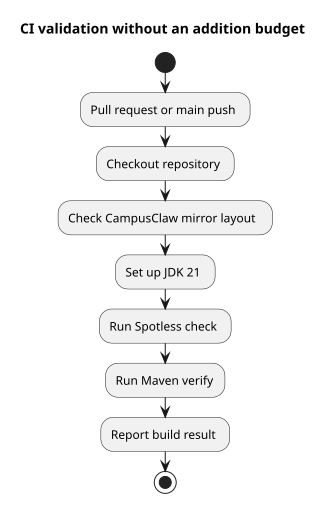

# 开发规模与 CI 验证

## 文档信息

| 项目 | 内容 |
|---|---|
| 文档版本 | v3.0 |
| 更新日期 | 2026-09-14 |
| 分析源码基线 | `pi-mono-java@09b32d8ea4a4b43b34be302d8b2745bdc417c9a2` |
| 适用范围 | 单次开发、提交、PR、模块与公司镜像的交付规模，以及 GitHub Actions |
| 变更类型 | 产品约束取消、仓库 CI 架构变化 |
| 决策状态 | Accepted |

## 1. 当前规则与理由

单次开发、单个提交和整个 PR 均不设置新增代码行数上限；模块侧与公司镜像也不设置配套行数预算。
任务按职责、依赖和可独立验证的交付边界划分，完整实现与必要测试可以在同一主题 PR 中交付。
固定行数预算会使同一职责的实现、测试和生成镜像被迫拆开，也不能准确衡量评审难度。

开发者仍需保持一个 PR 一个主题，说明用户或开发者影响、风险及验证结果；公共入口达到完整验收条件后才发布。
Java 方法/构造器长度、代码规范、测试、镜像一致性和 Git 发布流程继续由各自规范约束。
历史文档中的新增行数与门禁通过记录只描述当时的交付证据，不构成现行额度或验收要求。

## 2. 源码证据与目标差异

以下均为分析基线的已观察行为，路径相对于实现仓：

| 已观察行为 | 源码证据 |
|---|---|
| PR 与 main push 的 build job 在业务检查前运行新增行门禁及其测试 | `.github/workflows/ci.yml:3-24`，`jobs.build.steps` |
| 脚本对共同祖先到 head 的最终非文档 additions 汇总，超过 2000 行返回失败 | `scripts/check-commit-additions.sh:6,53-132`，`MAX_ADDED_LINES`、`check_pull_request` |
| 测试验证 2000/2001 边界、多提交汇总、重命名和 Git 读取失败 | `scripts/tests/check-commit-additions-test.sh:87-246`，`test_basic_limits` 等测试函数 |
| 行数步骤之后已有镜像布局、JDK 21、Spotless 和 Maven verify | `.github/workflows/ci.yml:26-41`，`jobs.build.steps` |

目标变更删除新增行检查脚本、专用回归测试及 CI 调用，保留其余工作流步骤和触发条件。
该变更属于仓库交付规则调整，不涉及 pi Runtime 行为，也不新增 Maven 或其他直接依赖。

## 3. CI 流程

[PlantUML 源文件](commit-addition-limit/diagram.puml#L1)

PR 或 main push 触发 build job，Checkout 后执行公司镜像布局检查，配置 JDK 21，
检查 Spotless 并执行 Maven verify。任一步失败仍按 GitHub Actions 的既有顺序停止后续步骤。
CI 不再接收用于行数统计的 base/head SHA，也不再执行新增行统计。

## 4. 决策、影响与边界

[ADR-0108：取消开发新增行数限制](../decisions/0108-remove-addition-limit.md)记录取舍。

- 产品约束取消：完整主题的代码、测试和镜像可以超过旧行数预算，无需为行数拆分提交或 PR。
- CI 架构变化：移除新增行统计及其专用测试，不用更大的阈值、豁免开关或恒成功脚本替代。
- 调用方迁移：维护中的开发与设计指引不再要求执行已删除脚本；依赖该脚本的外部自动化应删除该调用。
- 校验范围：删除仅服务于行数门禁的 Git 对象读取检查，不影响构建、测试或运行时输入校验。
- 维护成本：不再维护文档路径分类、重命名计费或 additions 边界测试；评审者按职责和风险判断变更是否适合合并。
- 运行时 API、持久化、依赖及模块/镜像内容没有变化。

## 5. 验证与验收

- CI YAML 可解析；与源码基线比较，只有两个新增行步骤被删除，其余结构一致。
- 所有工作流、hook 与活动脚本均不再引用已删除的门禁及测试；维护中的设计不再定义配套预算。
- 执行保留的公司镜像布局检查；本变更未修改 Java，不运行无关业务全量测试。
- 在本主题目录执行 `plantuml -tsvg diagram.puml`，校验 ASCII、SVG XML、文档链接/行锚及重复生成一致性。
- 校验 Markdown 无 Mermaid，执行 `git diff --check`；实际执行结果记录在交付 PR。

## 6. 版本历史

| 版本 | 日期 | 说明 |
|---|---|---|
| v3.0 | 2026-09-14 | 取消开发、提交和 PR 新增行数限制及模块/镜像预算，移除 CI 门禁与专用测试。 |
| v2.0 | 2026-09-03 | 将 2000 行限制从每个提交调整为整个 PR 的最终新增非文档代码行总量，并以 ADR-0048 取代 ADR-0047 |
| v1.1 | 2026-09-03 | 修复 Git 读取假绿、docs-to-code 重命名与 merge-only 绕过，固定评审实现提交，并将冲突 ADR 编号调整为 0047 |
| v1.0 | 2026-09-03 | 新增每个普通提交最多 2000 行非文档新增内容的 CI 门禁设计 |
