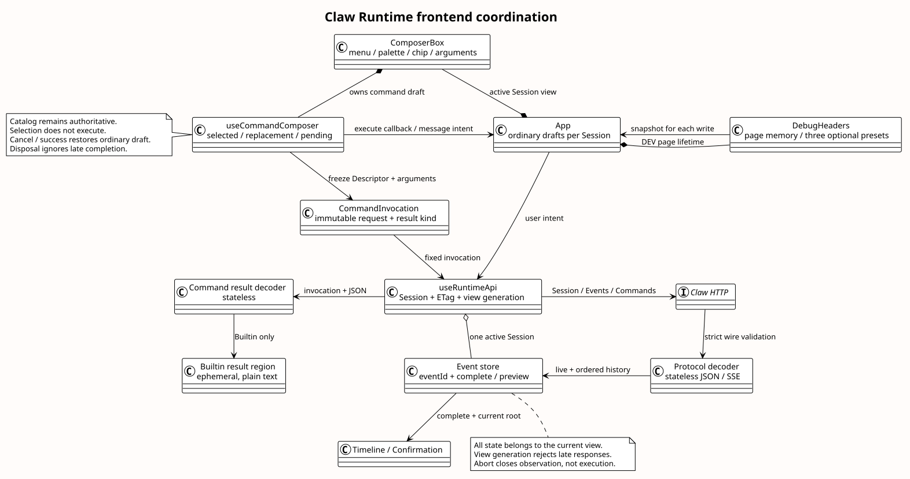

# Claw Runtime Session Events 前端实现

| 属性 | 值 |
|---|---|
| 版本 | 1.3.2 |
| 日期 | 2026-09-10 |
| 状态 | 前端已实现；本次以契约 fixture 验收，真实后端 E2E 未验收；不是生产 Mate 前端 |
| 初始源码基线 | `pi-mono-java@821418e7f2ece298a04a066ab8d11d3388ef2f16` |
| 同步源码基线 | `pi-mono-java@9b01a9f1e659359b6a7bff9ec622e6700ef6e384`；经 c57db26d 同步消息受理/控制分发，再同步控制受理与旧 Entry 拒绝；本文消费的 VO 不变 |
| 工作台源码基线 | `pi-mono-java@8fbafdb0b7ea5cdb8f22704610e5a86fc6f91bf1`；同步 `5add3aef18138e9197cc8bd9a37805d6ac4b742b` 仅涉及独立 Java 测试，前端未变 |
| Headers 定位修复基线 | `pi-mono-java@f61906b9136246ca60f333704b6fc92b5420d0ec` |
| 开发代理配置基线 | `pi-mono-java@33c3951ddecb8585881c8ec75265c6aa63145e83` |
| 已确认工作台设计 | `pi-mono-java-design@db3223c498e50c383cb620abe3a3fde2e3872845`；前端 1.10.0、Slash 前端 1.5.0、`runtime-workbench-alignment.md` |
| 已确认目标契约 | `pi-mono-java-design@9b8c5b7`；Claw Events B01～B15、Slash 前端 1.3.0；用户本次明确对接 Claw Runtime |
| 决策 | [ADR-0102](../../decisions/0102-runtime-events-v2-frontend.html)、[工作台 ADR-0105](../../decisions/0105-workbench-session-stop-and-auth.html)、[Headers 定位 ADR-0106](../../decisions/0106-headers-workspace-positioning.html) |

## 背景、定义与交付边界

旧工作台消费 HTTP 1.38 的 `message/fileIds`、命名 SSE、字符串历史游标及三种独立控制接口。
1.0.0 交付时后端会话并行实现 Session Events；前端任务只改 `frontend/` 与前端文档，不改 Controller、Service、
数据库、企业镜像或公共 Mate 契约。接口技能用于核对已有字段和消费状态，不引入新协议字段。

“回执”是当前 POST 第一个完整 user.* 事件；它证明接收，不证明执行完成。
“预览”是 agent.message/thinking 的 delta；完整记录以相同 eventId 覆盖预览。
“确认等待”是对应 sourceEventId 的 confirming idle，只关闭本段 SSE，Session 仍 running。
“命令结果”只指 Builtin 的页面临时 JSON；Skill 复用消息、工具和终态。

## 源码证据、目标决定与理由

以下路径相对实现仓。初始基线与同步基线中这些接口文件内容一致；本次不重新推导 pi Runtime 内核，
不把前端协议投影描述为 pi 内部实现。

| 源码 / 符号 | 已观察行为 | 本次前端处理与理由 |
|---|---|---|
| `frontend/src/composables/useRuntimeApi.ts`（改造前）· sendMessage/steer/followUp/abort | 旧请求字段、独立控制路径；曾以同文历史确认提交 | 移除旧路径，禁止同文确认；无回执保留草稿，避免重复副作用（安全加固） |
| `modules/coding-agent-cli/src/main/java/com/campusclaw/codingagent/runtimeapi/vo/SubmitSessionEventRequestVO.java`、`SessionUserEventRequestVO.java` | 新 event 包装和三种输入联合类型已经存在 | 严格按已确认目标组装；不发送幂等键、执行 ID 或内部序号（产品约束） |
| 同目录 `SessionEventResponseVO.java`、`ListSessionEventsResponseVO.java` | 完整事件的显式字段与 Long nextPage/null 已存在 | 共享解码、eventId 合并、数字分页；不按 createdAt 排序（架构调整） |
| 同目录 `CommandListResponseVO.java`、`BuiltinCommandRequestVO.java`、`SkillCommandRequestVO.java` | Descriptor/input 省略、Builtin 与 Skill 请求分支 | 保留服务端顺序，提交前冻结调用快照，不由 JSON 形状猜响应（安全加固） |
| `modules/coding-agent-cli/src/main/java/com/campusclaw/codingagent/runtimeapi/web/RuntimeCommandController.java` · execute | Builtin JSON / Skill SSE 共用 singular command，拒绝 If-Match/Idempotency-Key | Gateway 固定请求 Accept 和解码分支；命令不套配置 PUT 的版本头 |
| 同目录 `RuntimeEventController.java` · submit/list | 当前 af858b85 已接联合请求、data-only SSE 与公共历史 | 前端按当前契约解码；真实后端 E2E 仍需独立验收 |
| `modules/common/src/main/java/com/campusclaw/common/constant/ClawConstants.java` · EVENT_FILE_ID_REGEX/Skill.NAME_REGEX | fileId 为 32 位十六进制；Skill 名允许数字起始及连字符分段 | 请求构造和 Catalog 测试使用对应格式；不凭旧示例编造 file- 前缀 |

当前服务与消费边界的源码基线为 `af858b85ad2a5d2894360ce64accfdbe33d1418c`。
[事件边界设计](../runtime-public-stream/README.md)集中定义原始推理、工具关联与读取约束。

### 工作台交互的源码证据

实现仓路径均相对仓库根。设计仓依据位于 `01-总体架构/04-CampusClaw前端体验/`，
以及 `04-命令与技能/00-Slash-Command通用模块/前端设计/README.md`。
Codex 只作为用户已确认的按钮和入口参考；本变更不重新设计 pi 内核、Steer/FollowUp 或公共 Mate 契约。

| 8fbafdb0 源码 / 符号 | 已观察行为 | 当前决定、分类与理由 |
|---|---|---|
| `frontend/src/App.vue` · threads/drafts/createSession | 列表与选中会话只有页面内存，刷新丢失入口 | 架构变化：`useWorkbenchSessions` 与 `SessionIndexRepository` 保存索引，后端历史仍是权威记录 |
| 同文件 · stop/ComposerBox | 停止位于顶栏，Composer 始终使用提交箭头；健康状态持续显示核对按钮 | 产品约束：主操作槽发送即转停止，异常时才显示“刷新状态”，使状态与动作一致 |
| `frontend/src/components/ComposerBox.vue` · more menu | + 菜单打开命令 | 产品约束：+ 归属附件/上下文；命令通过 / 与标签更换，运行中独立执行 |
| `frontend/src/debugHeaders.ts` · validateDebugHeaders；`DebugHeaders.vue` · snapshot | 空预置忽略，按操作获取快照；空格值计数先于 Headers 规范化 | 正确性修复：先去除 SP/HTAB 再计数，CR/LF 仍先拒绝；每个后续 POST 获取最新有效值 |
| `frontend/src/composables/useRuntimeApi.ts` · canSend/recover | 仅资源 idle 可重新开放发送；观察不确定性仅在内存 | 安全加固：保留最小提交身份，历史未完成或已受理但缺失终态时不能重发 |
| `frontend/vite.config.ts` · server/plugins | 只有 Runtime 代理，没有认证中心登录能力 | 架构变化：新增 DEV 本地认证边界，页面提交 IP；账号密码由本地服务读取，避免浏览器直接提取 HttpOnly Cookie |
| `frontend/src/runtime.css` · conversation-scroll/composer-wrap | 绝对定位的无障碍提示可越过滚动容器；窄屏焦点导致根容器上移 | 正确性修复：明确定位容器，焦点切换不滚动根容器，无清单时 Composer 不被结果区域挤压 |

新增实现符号位于本变更，不属于上述旧 commit：`useWorkbenchSessions`、
`SessionIndexRepository`、`useDebugAuth`、`createAuthMiddleware` 和 `loginAuthCenter`。
自动认证只实现已批准的本地开发方案；生产认证、上传以及独立 Palette/Chip/Gateway 的完整组件拆分仍为 target-only。

## 目标结构与数据流

[PlantUML 源码](./diagram.puml#L1) · [原尺寸](./frontend_event_coordination.svg)

本图是当前落地的推荐目标结构，不另维护旧实现类图。
`useWorkbenchSessions` 持有列表、当前选择及内存草稿，`SessionIndexRepository` 只保存白名单索引字段。
`useRuntimeApi` 持有当前视图的资源/ETag、流读取器、请求代次和状态；组件只发用户意图。
协议解码与事件合并是纯函数，HTTP live 与历史必须共用。
协议验证只要求工具 arguments 为对象，业务参数错误留给执行层形成失败结果。
工具结果按 sourceEventId 与 toolCallId 关联；确认回执按调用之后、下一条 user.message 之前的提交顺序匹配。
工具表单以 eventId 标识，Provider 在新一轮复用 toolCallId 时重新创建。命令快照在 POST 前固定，
Builtin Renderer 消费相同快照；Skill 不进入临时结果区。响应解码失败不更新权威资源。

会话切换 abort 旧视图的 Fetch 和 reader，代次阻止迟到结果污染新会话。关闭观察不是业务取消。
同一视图中完整回执与历史都按 eventId 去重，完整消息覆盖预览，晚到 delta 不会追加到完成消息。
普通分页按响应顺序暂存到全部读取成功，再与实时尾部合并；失败不删除当前可见记录。
`nextPage=null` 只结束当前翻页，不能宣布执行完成。没有跨页快照或时间下界。

## 关键决策与界面行为

- 单 Session 新消息在 idle 才可发；2048 Unicode code point 上限。已上传 fileId 的构造函数支持
  最多 4 个引用及纯附件请求，但**上传尚未接入**，按钮明确禁用；不编造上传 API 或假上传成功。
- 消息/Skill 开始提交即将右下角换为停止按钮，收到可信回执和运行状态后才启用；顶栏不重复停止。
  停止提交固定 root user.message.eventId。中断回执只显示正在停止；对应真实终态才解除，保留下一条草稿。
  运行中普通输入框 Enter 不发送也不停止；选中命令在独立区域执行，停止槽始终保留。
  409/过期决定保留意图，用户重新核对，不自动改绑下一轮或重发控制。
- 工具确认仅对当前根消息的有效待确认 toolCallId 开放；本次 allow 不发送 denyMessage，deny
  允许非空可选说明，最多 2048 code point；读取 Runtime 回执与历史时接受 4096 UTF-16 单元。参数和工具结果使用文本；不执行其中的 Markdown 链接或图片。
- 空草稿首字符 `/` 打开输入框上方的清单；+ 只提供当前禁用的附件项。列表只显示规范名称和说明，不带前导
  `/`、kind、逐行 hint、标题或操作教学；移除独立 Slash 按钮与命令模式栏。
- 选中后收起清单并显示浅灰标签；点击名称更换、× 删除。参数单独编辑，无 input 隐藏参数框并
  空闲时聚焦圆形上箭头，运行时聚焦命令区独立“执行命令”。第一次 Enter 只选择，第二次独立 Enter 或点击才执行；重复 Enter、IME
  composition/229 不选择或执行，Shift+Enter 换行。未知 Slash 不回退普通消息。
- 首次 Escape 关闭清单、保留查询；再次退出。更换时暂存原选择与参数，Escape 恢复它们。
  空参数区（无参数命令为提交按钮）Backspace 或标签 × 退出；仅有 `/` 时 Backspace 退出。
  取消/成功恢复普通草稿，失败保留命令草稿；切换 Session 清空命令临时状态。
- Catalog 仅在内存中缓存，GET 合并在途读取；Session 状态变化与命令 POST 后失效。
  更新后的 input 是权威展示提示，不能从 hint 推导参数枚举或硬编码 running 准入矩阵。
  清单加载/失败时禁止提交；已选命令消失、类型改变或不再接受已填参数时保留输入并报错。
  点击标签或菜单会移除原 DOM 节点，外部点击判断使用原事件 composedPath，防止误收起新清单。
- Model 空参解码 Models，带参解码 Session；后者必须有 ETag，并同资源一起应用。Models GET
  不能覆盖 Session.modelId/ETag。配置 412 只重读，显示当前真实值，要求用户再次选择。
- Help/Skills 都为纯文本临时卡，最多一条，离开当前会话即清除，不进入模型上下文或事件历史。
- 思考展示模型返回的原始推理，关闭后续 thinking 不隐藏既有原文。Assistant 继续已有安全 Markdown；
  不为只有工具调用、正文为空的完成事件伪造回答。
- 视觉保留 O1 品牌、浅暖灰导航和独立虚线活动框；命令行没有装饰图标列。窄屏清单单列，
  可滚动区带键盘入口，输入动作区不随 Palette 膨胀而被挤出视口。

### Headers 面板定位

源码基线 `f61906b9` 的 `frontend/src/style.css` 中，`.debug-headers-body` 相对
`.debug-headers` 按钮向左展开，`.topbar` 的层级为 5，左侧 `.sidebar` 为 10；面板自身的
层级 12 不能越过顶栏的层叠上下文。1024px 窗口、会话执行等待确认时，面板左边界为 47px，
会话列表右边界为 224px，勾选框和 Key 被列表覆盖。这是已复现的定位缺陷。

当前方案以 `.topbar` 为定位容器，面板在顶栏下方展开并与工作区右侧内边距对齐，宽度取
680px 与工作区可用宽度的较小值；顶栏与面板共享响应式内边距。导航收起时按实际工作区宽度计算，
手机宽度沿用同一定位规则，Key/Value 继续分行。面板高度受动态视口约束，超高内容在面板内滚动。
这是工作区布局的正确性修复，不改变 Runtime、请求快照或认证契约；不引入依赖、监听器或新的组件生命周期。
定位选择及取舍见 [ADR-0106](../../decisions/0106-headers-workspace-positioning.html)。

验收要求：执行中和空闲时不伸入桌面会话列表；320/390/768/801/1024/1440px 无面板横向溢出；
导航展开/收起后控件仍可操作；短屏聚焦最后一个 Value 时只滚动面板，不推移页面根容器。

## 错误、恢复与 DFX

| 情况 | 行为与安全边界 |
|---|---|
| POST 首回执丢失 | 显示提交结果不确定、保留草稿、禁止直接重复消息；同文历史不能确认本次请求。人工检查后在 idle 显式解除，不自动发送 |
| 已有回执、EOF 前没有对应 idle | 保留预览标记，GET 历史与 Session 对账；只有相同根消息终态/确认阶段有归属意义，不把任意资源 idle 当执行成功 |
| SSE/JSON 类型错误、旧 wire、畸形字段 | INVALID_RESPONSE；停止本段观察并核对，不兼容旧字段、不把未知内容包装成模型回答 |
| 读取失败或某页不合法 | 保持已有可见事件，显示错误；GET 可显式重试，所有写请求无自动重试 |
| Builtin 网络结果未知 | 保留命令草稿，通过 Session/Events 读取现状；没有虚构 commandId、进度或幂等键 |
| 切换/卸载 | 取消客户端观察和读请求，不声称后台取消；当前页面草稿按 Session 隔离，秘密不持久化 |

读取帧缓冲上限为 2 Mi 个 JavaScript 字符，超过即显式失败/对账，不截断完整事件再显示成功。
这是客户端保护，不是新增后端协议上限；高容量会话的内存/渲染与时间线虚拟化仍需单独压测。
工具参数不额外存日志或 localStorage；显示的安全内容由后端共享投影负责，调试环境必须受控。
临时 Headers 为每次消息/Skill/Builtin/停止/确认 POST 单独生成副本；GET/配置不复用，
Accept/Content-Type 固定并剔除禁止的版本/幂等/续流头，不把凭据带入历史或恢复请求。
预置 `access-token`、`X-HW-ID`、`Authorization`，Value 留空；只有预置名称未变且值为空时，
跳过校验、计数与快照。编辑或删除不自动补行；“增加请求头”仅增加一条空 Key/Value 并聚焦 Key。
删除最后一行或全部清空后为零行，焦点回到增加按钮。改名后的空值仍按普通自定义行报错。

## 刷新恢复与本地认证

### 会话索引与恢复

`SessionIndexRepository` 使用 schemaVersion=1；名称空间由 API base、配置 Agent 和 caller 组成，
保存 `activeSessionId`、最近条目的 Session/Agent 标识、标题、展示名、更新时间，以及
未完成操作的本地随机 id、kind、可选 rootId/receiptId。随机 id 只用于浏览器记录，不作为 HTTP 幂等键。
白名单序列化排除消息、命令参数、草稿、Headers、IP、Token 和密码；每次修改先合并最新存储，
多页签不互相切换导航，但 localStorage 不提供跨页签事务或后台会话清单。

创建响应一旦返回有效 Session ID 就保存，即使随后 GET 失败也保留恢复入口。刷新/重开只读取
选中 Session、Models 与全部历史；读取失败不能开放消息提交，也不会创建新会话。403/404 保留
条目并允许用户仅从本地列表移除。存储不可用或损坏有明确提示，当前页退化为内存；不清理其他名称空间。

消息、Skill、Builtin、停止和确认 POST 前保存最小操作标记，收到匹配回执后补充身份。
写操作失败但是否受理不确定时不自动重发；恢复不能凭相同文本、资源 idle 或任意其他根的结束记录解除。
已知回执必须对应其后的根消息阶段结束记录；无回执只允许用户在 idle 且不存在未结束根时人工确认。
确认等待只结束当前观察阶段，仍保持 running。读取流断开不会自动发送停止。

无 live stream 的运行会话最多进行六轮 GET 恢复，间隔 1、2、5、5、5、5 秒；隐藏时取消定时续查，切换或卸载同时取消视图读请求，
用户刷新状态或重新显示页面可开始新一轮。耗尽后展示“刷新状态”。状态与 ETag、历史读取都有视图代次保护。
已有历史只有完整读取成功后才对账，刷新失败不丢弃当前可见事件。

### 本地 DEV 认证接口

开发服务的 `/campusclaw-service` 代理在 `frontend/vite.config.ts` 中显式配置 `secure: false`，
连接 HTTPS 后端时跳过上游证书验证。这是用户指定的本地联调产品约束；基线 `33c3951d` 的
`server.proxy['/campusclaw-service']` 未设置该选项。它仅作用于此代理，本地认证助手仍使用独立
HTTPS 客户端并保留 TLS 校验。配置与取舍见 [ADR-0107](../../decisions/0107-dev-proxy-secure-false.html)。

接口为 **`POST /__debug/auth/token`**，不是企业公共 API；DEV 私有路径、固定中文错误和
本机来源约束是产品范围例外，不增加公共登录资源、JWT/APPKEY 验证器或 Java Controller。
仅 `configureServer` 注册，DEV 组件条件异步加载；生产 bundle 不含认证请求代码，`vite preview` 无此路由。

| 契约项 | 定义 |
|---|---|
| 请求 | 同源 JSON `{ "ip": "192.0.2.10" }`；仅一个必填 IP 字段，接受裸 IPv4/IPv6，拒绝 URL、域名、端口和额外字段；最多 2 KiB |
| 凭据 | 本地 `.env.local` 的 `CAMPUSCLAW_DEV_AUTH_ACCOUNT` / `CAMPUSCLAW_DEV_AUTH_PASSWORD`，不得有 `VITE_` 前缀 |
| 来源 | 本机回环 socket、localhost/127.0.0.1/::1 Host 及实际端口、同源 Origin；不开放跨源 |
| 上游 | 固定 HTTPS 443 `/service/AuthCenter/0.1.0/auth/login`，JSON `loginAccount/password`；不转发浏览器 Cookie/Headers，不跟随跳转，保留 TLS 校验 |
| 资源限制 | 上游总超时 10 秒，响应体最多 64 KiB；浏览器 12 秒超时，页面取消同步 abort 本地请求 |
| 提取 | 仅 2xx 接受独立 Set-Cookie 数组中唯一非空、非删除的 access-token；Expires 逗号不拆分 Cookie，Max-Age 优先；忽略 JSESSIONID，不向浏览器写 Cookie |
| 成功 | HTTP 200，`{ "resCode": "0", "resMsg": "Token 已获取", "result": { "accessToken": "synthetic-token" } }` |
| 失败 | 保留 HTTP 400/403/405/413/415/502/503/504；只含 `resCode/resMsg`，无 result、原始异常、账号、密码、Cookie 或 Token |
| 缓存与重试 | Cache-Control: no-store；无自动登录、自动重试、磁盘缓存或 Token 日志 |

错误码包括 `INVALID_AUTH_IP`、`INVALID_AUTH_REQUEST`、`DEV_AUTH_FORBIDDEN`、
`DEV_AUTH_NOT_CONFIGURED`、`AUTH_UPSTREAM_REJECTED`、`AUTH_UPSTREAM_TIMEOUT`、
`AUTH_TOKEN_MISSING`、`AUTH_UPSTREAM_UNAVAILABLE`。浏览器按错误码展示本地文案，不解析或透传上游错误文本。

页面显式点击后才获取，成功更新/补建并启用 access-token 行。请求期间任何 Header 编辑、清空、IP
变更或卸载使旧回填失效；IP 切换只清除未被用户改动的自动值。Token 的新增、手工覆盖与清空都只影响
后续各次 POST 的独立快照，既有请求不被改变；重复同名 Token 行先由用户修正，不静默挑选。

### 依赖与实施顺序

先建立索引与 Runtime 提交身份，再连接刷新恢复、停止/命令槽，最后装配 DEV 认证及回填。
新增开发依赖 `@types/node@24.13.3`，其类型依赖 `undici-types@7.18.2` 已在 lockfile 核实；
用于类型检查本地 Node HTTPS/HTTP middleware，不进入运行时或浏览器产物。
这是对设计“无新增直接依赖”的类型声明调整，已在安装前告知用户。替代方案为未类型化 JS 或手写声明，
会削弱当前严格 TypeScript 检查；无需 axios、Cookie 库或 Maven 依赖。主线同步只影响独立 Java 测试。

## 测试与验证

执行入口为 `frontend/package.json` 的 test/typecheck/build；Node middleware 及其测试均纳入严格类型检查。
本地运行及配置见 [frontend/README.md](../../../frontend/README.md)。

- Vitest 13 个文件、125 项：协议/SSE/分页、最新 Header 快照、空白归一化、命令/草稿、停止和控制、
  刷新/重开索引、创建后读取失败、迟到视图、六轮 GET 上限、未知提交不重放、Token 回填竞争、Cookie
  提取、来源/Host 校验、固定 HTTPS 请求、重定向拒绝、超时、大小限制及错误脱敏。
- 实际 Vue + 本地 fixture：刷新和新标签页恢复、运行中独立 Help、两次 Enter、输入框 Enter 不停止、
  停止终态后恢复箭头并保留草稿、+ 禁用附件项、Headers 0→1、认证缺配置提示。
  320/390/768/1440px 无横向溢出；390px 验证并修复无障碍提示越界引起的根容器滚动。
- Headers 定位回归使用 Chrome + 本地 fixture：上述六种宽度下可见输入框和按钮均命中自身，
  没有被会话列表或会话内容覆盖；1024px 面板边界修正为 326～1006px，801px 为 242～783px。
  实际操作勾选、Key 聚焦和 Value 编辑；执行等待确认及停止后的空闲状态正常。
  320×480px 聚焦末行后面板 scrollTop=125、根容器 scrollTop=0，末行仍可点击。
  定位修复的 125 项测试、类型检查、构建、依赖审计和 Spotless 均通过；协调图重新生成后与基线一致，
  ASCII/XML/链接/行锚点及原尺寸、缩放视图检查通过。
- 必须通过类型检查、生产构建、`npm audit --audit-level=high`、生产 DEV 路由缺席检查、
  PlantUML 生成/ASCII/XML/链接/同步、SVG 原尺寸与缩放检查、`git diff --check`、2000 行新增代码门禁。
- 未验收：真实认证中心与 Java 后端 E2E、上传、生产 Mate、真实 IME/读屏器/200% 缩放、长历史压测。
  fixture 不证明真实认证或服务端权限；Java 编译/后端测试与 mirror 不适用于本次前端文件变更；另按仓库提交规则运行 Spotless。

## 版本历史

| 版本 | 日期 | 变更 |
|---|---|---|
| 1.3.2 | 2026-09-10 | 开发代理显式设置 secure=false，允许连接本地联调的 HTTPS 后端。 |
| 1.3.1 | 2026-09-10 | 将 Headers 面板限制在实际工作区内，避免较窄窗口的会话列表遮挡输入控件。 |
| 1.3.0 | 2026-09-10 | 保存会话恢复索引，统一停止槽与独立命令操作，并接入本地 IP 获取 Token。 |
| 1.2.0 | 2026-09-09 | 展示原始推理，修正失败工具事件读取、跨轮确认与拒绝说明长度。 |
| 1.1.0 | 2026-09-09 | 落实 Headers 预置与显式增删、命令标签与独立参数、统一箭头及草稿恢复；保留内部 Skill SSE。 |
| 1.0.0 | 2026-09-08 | 独立前端交付 Session Events、Slash、确认/停止与恢复；明确并行后端联调边界。 |
