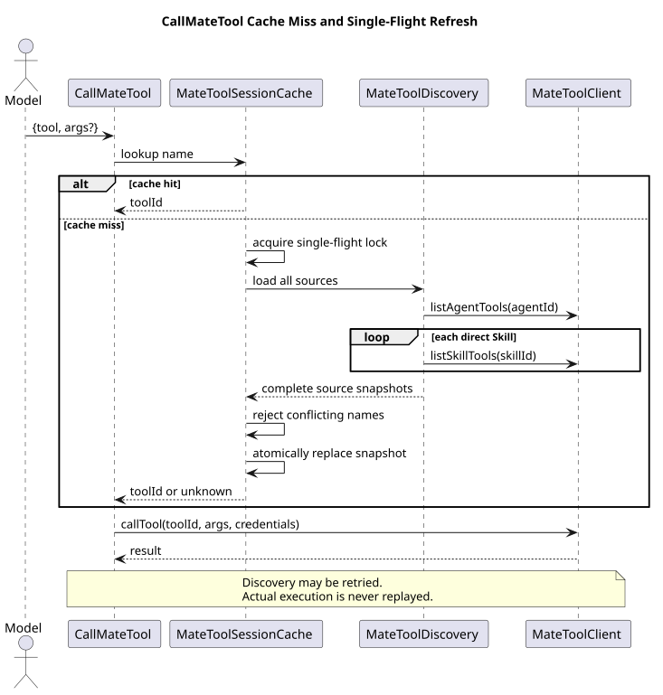

# Mate Tool Client 与 Session 发现设计

> 文档版本：2.4.1
>
> 状态：Implemented
>
> 更新日期：2026-09-19
> 决策记录：[ADR-0032](../decisions/0032-tool-execution-credential-boundary.html)、
> [ADR-0024](../decisions/0024-mate-tool-execution-credential-chain.html)、
> [ADR-0022](../decisions/0022-managed-agent-tool-system-v2.html)、
> [ADR-0026](../decisions/0026-unify-campusmate-client-configuration.html)

## 1. 源码基线与分层

历史分析基线为 `d649866a6cae967ace18ceaeb9597edd47e5721e`；凭据链实现分析基线为
`934b5dd7d9e50b1d7359bea5f2dda71e3c4a34ac`。历史基线客户端已经具备 Agent/Skill
绑定 ID 查询、批量元数据查询和执行 RPC，但工具层仍暴露 ID/scope，并要求 Call 前先 List。
本轮分析的变更前实现基线为 `320d790726a70aada6100052952d5494d2a378ac`：该实现把三项
执行凭据同时发送给发现和 execute。目标实现保留按名称调用：POST Events 额外读取
`access-token`，发现请求不携带这四项值，只有工具 execute 请求携带收到的值；这是接口契约
变更与安全加固。

Mate 凭据规则的目标设计基线为
`pi-mono-java-design@9e766a030aa4c777da96586db4c7778fc84c7995`；变更前源码基线为
`6a331d3477df23f8404582c3922b55c265530605`，已实现行为核验提交为
`db990ab3358798743ce63668035ab98fc0554a32`（2026-09-19 核验）。Claw 入口、工具层和
客户端不检查最低完整性；空或部分凭据也进入真实 Mate execute，由 Mate 返回认证或业务结果。

<a id="credential-source-evidence"></a>

### 1.1 Mate 凭据实现证据

以下路径相对 `modules/coding-agent-cli/src/main/java/com/campusclaw/codingagent/`，均核对
`db990ab3358798743ce63668035ab98fc0554a32`；不将该提交扩展为其他工具和历史基线的重新验收。

| 源码与符号 | 已核验行为 |
|---|---|
| `runtimeapi/event/RuntimeEventService.java#submit` | 不拒绝空或部分凭据；null 归一化为空快照，仅消息分支传递快照，控制分支不替换原值 |
| `tool/mate/CallMateTool.java#execute` | 不检查凭据完整性；保留名称解析和取消检查，再调用 Mate |
| `common/client/HttpMateToolClient.java#invokeTool/#toHeaderInfo/#toToolResult/#readRoot` | 校验工具 ID 后按快照调用 execute；Mate 非零响应映射工具失败，解析异常不回显响应正文 |
| `common/util/MateRestUtil.java#newRequestBuilder/#logAndWrap` | 只省略 null 或空字符串 Header；敏感异常不保留原 message/cause，保留非敏感定位和来源栈 |
| `common/client/mate/MateCredentials.java`、`common/dto/RequestHeaderInfo.java#toHeaders` | 不可变四项快照不再提供完整性判断；按原 Header 名映射且诊断字符串不输出凭据值 |

同一提交的 129 项聚焦测试于 2026-09-19 通过，包括真实 HTTP 的 16 种 Header 子集、null/空值
省略、失败请求次数和日志脱敏。真实 Mate 部署联调、不同凭据并行执行与完整控制续段端到端
验证、公司父 POM 独立构建和全仓 `clean verify` 未完成，不属于该测试结论。

| 层 | 当前类型 | 职责 |
|---|---|---|
| HTTP | `HttpMateToolClient` | 查询绑定 ID、批量元数据、恢复绑定顺序、执行 RPC |
| 契约 | `MateToolClient` | 发现方法不接收凭据；`callTool` 接收 POST Events 为当前执行读取的凭据值 |
| Session | `MateToolsetFactory` / `MateToolSessionState` | 每 Session 创建工具和私有缓存 |
| 发现 | `MateToolDiscovery` / `MateToolSessionCache` | 来源快照、完整名称索引、single-flight |
| 模型工具 | `ListMateToolsTool` / `CallMateTool` | 稳定 JSON 列表和按名称调用 |

`MateToolClient` 是共享无状态客户端；`AgentTool` 和 `MateToolSessionCache` 从不作为 Spring
单例跨 Session 复用。

## 2. ListMateTools

`ListMateTools({skillName?})` 无参数查询当前 Agent，有参数时只接受当前 Agent 直接绑定 Skill
名称。每次调用实时访问 Mate，不读取列表缓存。返回 JSON 只包含：

```json
{
  "scope": {"type": "agent"},
  "tools": [{"name": "Query", "description": "...", "inputSchema": {}}]
}
```

响应不包含 Agent/Skill/tool ID、permission、outputSchema 或并发属性。成功列表会更新该来源
的名称到 ID 快照，但不清空其他来源。

## 3. CallMateTool



[PlantUML 源码](tool-system-v2/diagram.puml#L120)

`CallMateTool({tool,args?})` 先查当前 Session 的完整有效名称索引。miss 由
`MateToolSessionCache.resolveOrRefresh` single-flight 加载当前 Agent 和全部直接 Skill：

- 同名同 ID 合并；同名不同 ID 使整轮刷新失败；
- 所有来源成功后才原子替换完整快照；
- 并发调用共享同一轮刷新结果，包括失败；
- 刷新后仍无名称时返回 unknown；
- 实际 execute 最多发送一次，连接或业务失败均不重放。

`args` 缺省为 `{}`。模型不提交 scope、Skill 或 toolId；Mate 服务仍是最终授权和执行权威。

## 4. HTTP 契约与凭据链

Agent/Skill 查询先取得有序绑定 ID，再向元数据端点批量查询。客户端按 ID 关联结果并恢复
原绑定顺序；缺失、重复或未知 ID fail closed。`listAgentTools(agentId)`、
`listSkillTools(skillId)` 和内部元数据查询均不接收 `MateCredentials`，因此 Agent binding、
Skill binding 和 tool metadata 三类发现请求都不发送执行凭据 Header。

Runtime 在接受 Events 或 Command 执行请求时读取可选的 `X-HW-ID`、`X-HW-APPKEY`、
`Authorization` 和 `access-token`。这些值只在本次 Agent 执行及其 Child 调用期间由内存中的
`MateCredentials` 持有，经 `RuntimeEventService`、`RuntimeSessionEngineRegistry`、
`ManagedAgentSessionRequest` 和 `AgentSessionFactory` 传递；不写入数据库、Agent 目录、Event、
Prompt、模型消息或日志。执行结束后 Runtime 不再主动持有这些值。实现不使用 ThreadLocal、
请求作用域 Bean 或进程级 resolver，共享 `HttpMateToolClient` 也不保存这些值；
`MateCredentials.toString()` 只显示各字段是否存在。null 参数统一归一化为不可变空快照；缺少
Host 执行上下文仍按既有错误处理，不与空快照混为一谈。消息或命令启动时固定快照，Child
只读继承，停止、确认和问答等控制请求不替换原执行快照。

Agent binding、Skill binding 和 tool metadata 查询不携带上述值。只有 `CallMateTool` 最终发送
`POST /mate-service/v1/runtime/tools/{toolId}/execute` 时，才把收到的非空值放入同名 Header；
AppKey 与 JWT 同时存在时都发送。值保持调用方提供的原值；Claw 不补值、不添加 Bearer、不从
其他请求借用凭据，也不校验必填项、组合、最低完整性或 AppKey/JWT 互斥性。工具合法、权限与
确认通过且未取消时，即使四项全缺也实际调用 execute 一次；Cron 的空凭据遵循同一规则。
Mate 是最终认证、授权和参数校验权威，execute 不自动重试。该行为是架构改造；pi 没有对应
Mate 工具或凭据链。

Mate 非零业务响应沿既有 `ToolResult(isError=true)` 路径返回统一失败文本；网络、构造或解析
异常沿既有通用工具失败路径返回，不新增凭据公共错误码。统一文本避免 Mate `resMsg` 或畸形
响应正文把秘密回显给模型。日志保留非敏感 operation、toolId、异常类型和原始来源栈帧；对
可能包含 Header value 或响应正文的异常不记录原始 message、cause 或正文。

## 5. CampusMate 共享配置

自 2.2.0 起，Tool 不再使用顶层 `mate.innerGWSerive` 或私有的 `mate.endpoints`。
`HttpMateToolClient` 与 Model、受管 Runtime 共享 `campusmate.base-url`，并从
`campusmate.endpoints` 取得 Agent、Skill、Tool 元数据与 Tool execute operation。
其中 Skill query 与受管 Runtime 共用一个 `skill-info-path-template`，不再重复配置。

完整结构、源码基线、迁移规则和配置可视化见
[CampusMate 客户端共享配置设计](campusmate-shared-config.md)。本次只修改配置架构，Tool 的
HTTP method、path 和请求响应保持不变；2.3.0 只改变哪些请求会携带凭据 Header。

## 6. 版本历史

| 版本 | 日期 | 说明 |
|---|---|---|
| 2.4.1 | 2026-09-19 | 补齐 Mate 凭据已实现行为的源码提交、符号及测试验收范围。 |
| 2.4.0 | 2026-09-19 | 取消 Claw 的 Mate 凭据完整性检查，按 execute 快照透传非空原值并收敛失败响应与敏感异常日志。 |
| 2.3.1 | 2026-08-28 | 用读取时机、内存持有期限、携带请求和缺失值行为定义工具凭据边界。 |
| 2.3.0 | 2026-08-27 | POST Events 读取 `access-token`；发现请求不携带四项值，只有 Tool execute 请求携带收到的值。 |
| 2.2.0 | 2026-08-26 | Tool 复用 CampusMate 单一 base URL、共享 Endpoint 目录与 Skill query operation；移除顶层 `mate.*` 配置。 |
| 2.1.0 | 2026-08-24 | 删除部署方 resolver 占位；POST Events 读取三项凭据并供当次 List/Call 和 Child 使用，Cron 缺少值时 fail closed |
| 2.0.0 | 2026-08-24 | PascalCase 双工具；按 Agent/Skill 方法拆分客户端；稳定 JSON；Session cache miss 自动完整发现且 execute 不重放 |
| 1.x | 2026-08-22 以前 | 历史 ID/scope List 与 Call-before-List 设计，已由 ADR-0022 取代 |
