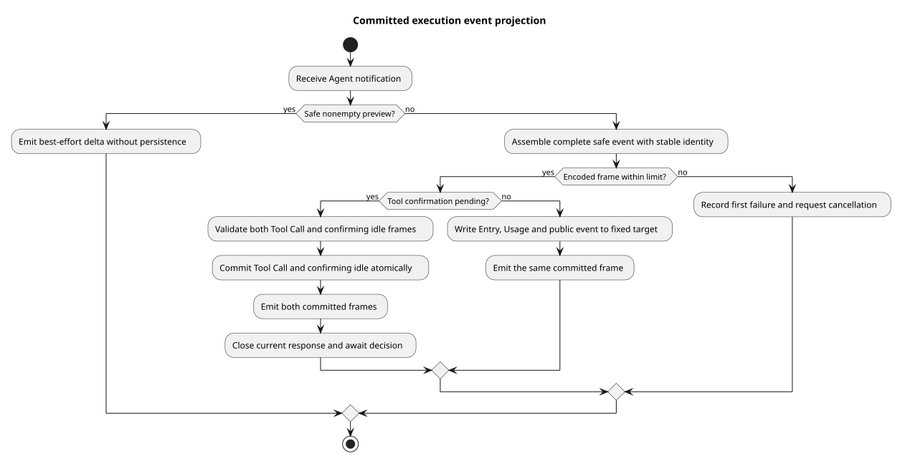

# Session Events 执行事件转换

> 版本：1.2.0 · 日期：2026-09-18 · 状态：由执行协调器接入 Session Events HTTP

## Context 与证据

Agent 的过程通知包含预览、内部消息和工具事件，不能直接当作公开历史。
本片把完成事件写入固定执行段，再发送相同结构的 SSE；预览不入库。
实现为 `bc8298fd`，其两份源码与最终集成 `da092cd1` 一致；前置代码基线 `40974151`
包含已确认的执行对象与权限支持，主线基础为 `2bdcdcb2`。
规范来自设计仓 `2ee2a3211da68ad87b0d9cab353e691b00bdaebd` 的
`01-总体架构/01-CampusClaw多Agent运行时/chat-events-design.md`。

| 实现仓相对路径与符号 | 观察、决定和理由 |
|---|---|
| `modules/coding-agent-cli/src/main/java/com/campusclaw/codingagent/runtimeapi/event/RuntimeEventProjector.java#persistAssistant/#persistThinking` | 完整事件先检查编码体积，再以固定执行目标组合写内部 Entry、Usage 和公共事件；发送使用同一个已组装帧。 |
| 同类 `#emitMessageDelta/#projectThinking` | 执行快照启用 Thinking 时发送模型返回的可读推理原文；忽略空文本，预览没有持久时间和 Usage。 |
| 同类 `#persistFinalizedToolCalls/#persistMissingToolCall` | 工具校验失败或权限拒绝也必须先有完整 tool_call；同一 Tool Call 不因后续执行通知重复写入。 |
| 同类 `#beginConfirmation/#persistConfirming` | 核对模型已完成的 Tool Call，原子提交 tool_call 和 confirming idle 后关闭本段响应，等待可信决定；续跑仍使用同一根事件。 |
| 同类 `#projectCompaction/#discardedEntryId` | 自动压缩保留精确 Entry 边界、重试候选身份及 Usage，公开事件仅含安全统计；无有效保留边界时拒绝。 |
| 同类 `#requireCommittedFrame/#recordFailure` | 每个完整帧在入库前受本征体积限制；只记录首个失败并发出一次取消请求，不把失败后的输出继续写入。 |
| `modules/coding-agent-cli/src/test/java/com/campusclaw/codingagent/runtimeapi/event/RuntimeEventProjectorTest.java` | 使用真实编码器和转换器，替换持久化边界；验证输出形状、写入目标、权限确认段与失败顺序。 |

pi 基线 `4af9d21d3b4d664e4a29fcabfec85171077248e3` 的
`packages/agent/src/agent-loop.ts#runLoop/#prepareToolCall` 提供消息、工具和取消通知，
没有公共事件库和结果段。持久化分段是 Java 架构变化；原始推理展示属于产品约束，完整帧大小限制属于资源保护。

## 流程与边界

[PlantUML 源码](diagram.puml#L1)

delta 只通过 best-effort 输出发送；完整事件必须先确定 ID、毫秒时间和安全载荷。
固定目标中的段可以因已接纳确认而变化，根事件保持不变。确认输出失败只影响连接，已提交确认状态仍由数据库保留。
跨实例续跑没有本地响应时仍执行相同编码体积检查和持久化，不能绕过输出大小限制。

AgentEnd 的取消标志补充实际退出证据；false 不代表成功，仍保留 Assistant 的 STOP、ERROR、ABORTED。
转换器拒绝新的排队 UserMessage；HTTP 中断和确认由独立服务接纳，不作为排队文本执行。
转换器经协调器接入 HTTP；接纳回执、最终 idle 提交和执行凭据释放仍由协调器和应用服务负责。

## 工具调用展示名称

本增量依据设计仓 `3e5f1189987c425c9987cce2fc261a5d3c59f1c8` 的工具系统 §9.2.1、
Session Events §2.3 与前端 §9.7，实现起点为 `19870445a3a8bd559919fe24580330be8227488f`；仅扩展工具元数据和公开调用事件字段，
不改变上文历史 pi 证据、Agent 内核事件或模型工具参数。

`RuntimeSessionEngineRegistry` 从本次装配的 `ManagedAgentSession.tools()` 创建
`RuntimeToolCallSnapshotResolver`，按执行隔离并绑定至 `RuntimeActiveExecution`。
普通工具的 `label()` 映射为可选 `displayName`；`CallMateTool` 使用具体业务工具的
`MateToolResolutionDTO`，把 ID、技术名与展示名一并固定到本次调用。
Mate 不可用或没有有效业务展示名时省略该字段，不能使用外层 `CallMateTool` 标签。
`HttpMateToolClient` 保留网关 `display_name`，`MateToolSessionCache` 原子更新来源快照；
同名不同 ID 仍拒绝，同名同 ID 的展示名冲突仅省略展示字段。

`RuntimeEventProjector.persistFinalizedToolCall` 在首次调用提交前解析快照，覆盖直接执行、
拒绝与等待确认；网络发现不进入追加事务。调用与确认续跑共享已绑定工具 ID，目录刷新不改变
本次执行对象。`RuntimeCommittedEventFactory.agentToolCall` 将规范化展示名写入现有 JSON payload，
`CommittedEventProjection` 和 `AgentToolCallResponseVO` 供实时与历史共用；无有效值时省略字段。
名称不进入模型上下文，不从模型 arguments 或结果文本取值，不参与执行授权。
解析失败仍保存调用并由工具执行路径返回失败结果；执行凭据和现有权限检查保持。

前端 `runtime/toolDisplay.ts` 统一活动行和确认卡标题：有效 displayName、原始技术名、名称缺失提示。
CallMateTool 的技术名来自 arguments.tool；普通工具来自 toolName。详情和可访问名称保留完整标题，
仅视觉摘要可省略。内部 Runtime 本次贯通，公共 Mate Chat bridge 不在此实现仓中。
不设计存量记录迁移、回填或兼容，不新增数据库对象或依赖，现有流程图结构保持。

## 性能、验证与决策

转换按事件处理，保存当前 Assistant 和工具身份映射；压缩时按 500 条批量读取当前分支。
不新增线程、数据库对象、依赖或升级流程。单次完整事件体积受配置上限限制，预览队列容量由输出实现控制。

JDK 21 下相关后端测试合计 104 个通过，零失败、零跳过；覆盖网关元数据、缓存冲突与刷新、
调用身份固定、框架标签映射、不可用 Mate、确认前快照、实时与历史投影一致性，以及装配和权限回归。
根 Reactor 的 Spotless、Checkstyle 通过；Java 方法长度、字段布局和新增类型文档经机械与人工检查。
测试质量脚本在新增或修改的测试方法中无错误；对未修改方法报告的 7 个缺断言告警已核实为
未识别 `assertThatThrownBy` 或辅助断言的误报。

前端 35 个文件、262 项测试通过，类型检查和构建通过。使用本地契约 fixture 在 390×844 与
1440×1000 视口核验具体名称、长名称省略、完整详情与可访问名称、允许/拒绝及刷新恢复。
浏览器验收不代表真实 Mate 或 Java HTTP 端到端联调；本增量未运行真实 openGauss 集成测试。

公司镜像已同步并逐文件核对生成内容；企业 `NativeParent:26.0.0-SNAPSHOT` 本机不可解析，
企业 Maven 编译未验证。PlantUML 重新生成与现有 SVG 一致，XML、ASCII、图片及源码链接检查通过；
`git diff --check` 通过。

[ADR-0093](../../decisions/0093-project-committed-execution-events.html)；原始推理规则见 [ADR-0104](../../decisions/0104-original-reasoning-and-event-contract.html)。

| 版本 | 日期 | 说明 |
|---|---|---|
| 1.2.0 | 2026-09-18 | 工具调用保存 displayName 快照，贯通框架 label、业务元数据与前端展示。 |
| 1.1.0 | 2026-09-09 | 按执行开关展示原始推理，统一 Events 类名。 |
| 1.0.0 | 2026-09-08 | 记录固定目标事件转换、确认段、安全投影和失败边界。 |
