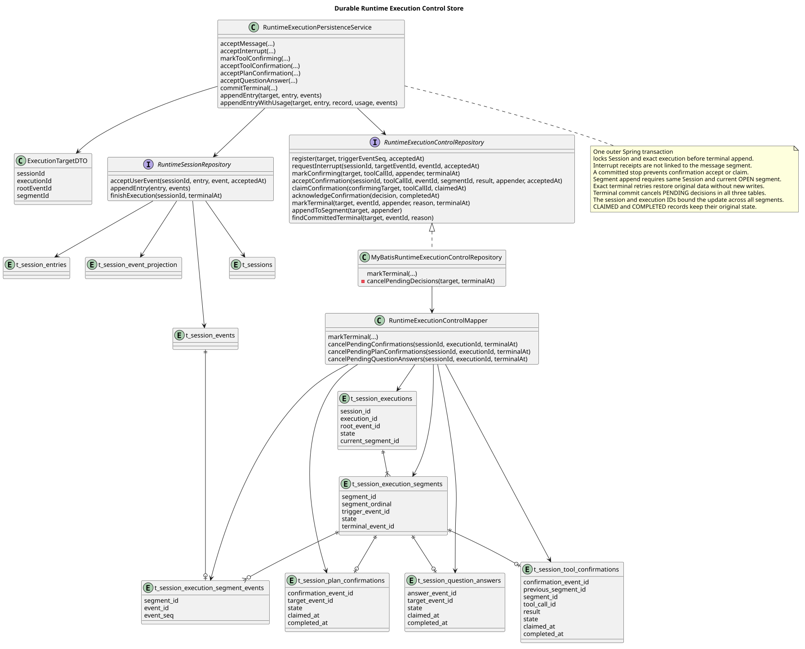
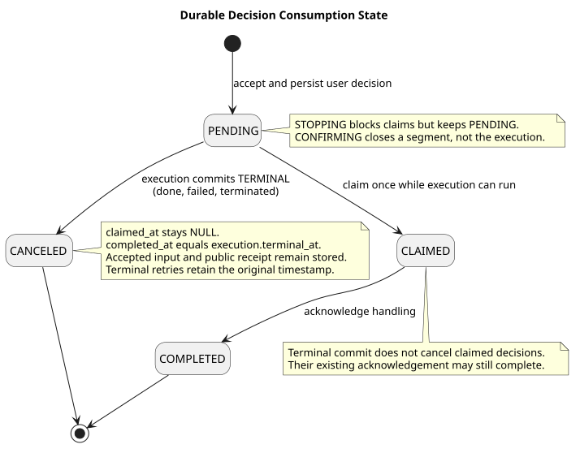

# 固定执行控制与应用事务

| 属性 | 值 |
|---|---|
| 版本 | 0.5.0 |
| 日期 | 2026-09-17 |
| 设计契约 | `pi-mono-java-design@1ae37aa31ccfe3f371b9e08a7cb89591b97037a8` |
| 变更前 Java 源码基线 | `pi-mono-java@74f1b8314c9a5eb3d1659dfed2ab90b787dd647f` |
| Java 实现范围 | 上述基线及本设计配套的未领取决定终结实现；源码入口见下表 |
| pi 源码基线 | `pi@4af9d21d3b4d664e4a29fcabfec85171077248e3` |
| 范围 | 固定执行存储，消息/中断/进入确认/三类决定/真实终态事务；HTTP、轮询和等待登记由各自设计维护 |

## Context

设计仓的 `chat-events-design.md` §4.4～§4.6 要求在执行开始前固定内部执行身份，
把原 `user.message.eventId` 作为根事件，并为初始响应和每次确认续跑建立不同结果段。
这样迟到的中断不能只凭 Session 当前状态误停下一轮，确认续跑也不会把新输出写回已经关闭的响应。

工具确认、计划确认和问题答案在受理后保存为持久化决定，由原执行实例至多领取一次。执行可能在
决定受理后、领取前停止或超时；这时决定不得继续消费。执行真实终结时，将尚未领取的决定统一置为
`CANCELED`，明确表达“本次执行不再消费”，同时保留用户提交的决定及其公共回执。

## 源码证据与设计理由

| 分类 | 路径与符号 | 观察与理由 |
|---|---|---|
| 基线实现 | `modules/coding-agent-cli/src/main/java/com/campusclaw/codingagent/runtimeapi/persistence/RuntimeExecutionControlRepository.java` | 定义登记、精确读取、完整事件关联、决定 accept/claim/ack、confirming 关段和真实终态 CAS |
| 基线实现 | `modules/coding-agent-cli/src/main/java/com/campusclaw/codingagent/runtimeapi/persistence/MyBatisRuntimeExecutionControlRepository.java#lock/lockExecutionForClaim` | 统一先锁 Session，再锁固定执行；停止状态优先于领取，拒绝过期 segment 和重复终态 |
| 基线实现 | `modules/coding-agent-cli/src/main/java/com/campusclaw/codingagent/runtimeapi/persistence/RuntimeExecutionPersistenceService.java#acceptMessage/acceptInterrupt/acceptToolConfirmation/acceptPlanConfirmation/acceptQuestionAnswer/commitTerminal` | 外层 Spring 事务组合 Session、Entry、公共事件和固定执行状态 |
| 基线实现 | `modules/coding-agent-cli/src/main/resources/mapper/session/RuntimeExecutionControlMapper.xml#claimConfirmation/claimPlanConfirmation/claimQuestionAnswer/findPendingControls` | 领取要求原执行仍为 RUNNING 且未接受停止；控制轮询排除 TERMINAL 执行，固定身份阻止旧决定进入新执行 |
| 配套实现 | `modules/coding-agent-cli/src/main/java/com/campusclaw/codingagent/runtimeapi/persistence/MyBatisRuntimeExecutionControlRepository.java#markTerminal/cancelPendingDecisions` | 执行成功转为 TERMINAL 后，同一事务取消三类决定表中尚未领取的记录 |
| 配套实现 | `modules/coding-agent-cli/src/main/resources/mapper/session/RuntimeExecutionControlMapper.xml#cancelPendingConfirmations/cancelPendingPlanConfirmations/cancelPendingQuestionAnswers` | 按 sessionId/executionId 取消全部段的 PENDING 决定，completed_at 使用执行终态时间 |
| 配套实现 | `modules/coding-agent-cli/src/main/java/com/campusclaw/codingagent/runtimeapi/session/ToolConfirmationState.java` 与 `modules/coding-agent-cli/src/main/resources/db/gaussdb/install/session_schema.sql` | 三类决定共用 PENDING/CLAIMED/COMPLETED/CANCELED；CHECK 约束状态与领取、结束时间一致 |
| 基线实现 | `modules/coding-agent-cli/src/main/java/com/campusclaw/codingagent/runtimeapi/persistence/MyBatisRuntimeSessionRepository.java#beginDeletion/completeCleanup` | 显式删除 idle Session 才登记异步清理；物理删除不承担执行终态时的消费状态收尾 |

`CANCELED` 是配套实现增加的消费终结状态，未包含在变更前 Java 基线中。

pi `packages/agent/src/agent-loop.ts#runAgentLoop` 使用调用方提供的 `AbortSignal` 驱动一轮循环，
`prepareToolCall` 在工具执行前再次检查该信号。pi 没有 CampusClaw 的共享数据库、HTTP Session 资源或
跨实例路由。固定数据库身份与消费终结状态属于 CampusClaw 架构变化，不把它们描述为 pi 已有能力。

## 架构与数据流

[PlantUML 源码](diagram.puml#L1)

`t_session_executions` 为一个根消息保存不可复用的 `execution_id`、公开 `root_event_id`、当前
`segment_id` 和控制状态。同一 Session 只允许一条非 TERMINAL 执行。
`t_session_execution_segments` 按序保存初始段和确认续跑段；关闭段时固定唯一 idle 事件及原因。
`t_session_execution_segment_events` 只关联实际属于该 HTTP 结果段的完整事件，后续中断回执不会
因此自动进入原消息段。三类决定分别保存在 `t_session_tool_confirmations`、
`t_session_plan_confirmations` 和 `t_session_question_answers`，共同关联固定执行、确认前后段和
公共回执。问题答案通过回执关联保留；工具与计划确认保留其结果和用户说明。确认凭据不落库。

## 消费状态

[PlantUML 源码](diagram.puml#L155)

| 状态 | 含义 | `claimed_at` | `completed_at` |
|---|---|---|---|
| `PENDING` | 已受理，尚未被原执行实例领取 | NULL | NULL |
| `CLAIMED` | 已被原执行实例领取，尚未确认处理结束 | 非 NULL | NULL |
| `COMPLETED` | 已领取的决定处理结束 | 非 NULL | 非 NULL |
| `CANCELED` | 执行已真实终结，尚未领取的决定不再消费 | NULL | 执行的 `terminal_at` |

`CANCELED` 只描述消费终结，不表示用户撤回，也不等于工具执行成功或失败。`completed_at` 表示
处理完成或取消消费的时间，具体语义由 `state` 区分；不伪造领取时间，不把未消费决定改成 `COMPLETED`。
取消消费保留用户已提交的决定和公共回执，不撤销计划批准时已提交的模式切换。

停止进入 `STOPPING` 时，决定暂时仍为 `PENDING`，领取条件已阻止继续消费。只有执行进入真实
`TERMINAL` 时才取消消费。`done`、`failed`、`terminated` 使用同一收尾规则；进入 `CONFIRMING`
的段结束不是执行终结，不触发取消。`CLAIMED`、`COMPLETED` 和既有 `CANCELED` 均不被改写。

## 事务与锁顺序

`RuntimeExecutionPersistenceService` 是应用事务边界。底层 Repository 使用 Spring `REQUIRED` 传播。
消息准入持有 Session 行锁，先分配统一序号并写 Entry、公共事件和完整性标记，再创建新的执行身份与结果段；
中断、进入确认和真实终态先锁已有 Session 和固定执行并校验当前结果段身份，再分配统一序号并写完整事件，
最后写段关联。任一步失败都会回滚同一事务内已写的数据与统一序号。

- `acceptMessage` 先通过 Session 准入事务写 `user.message` Entry 与公共事件，再登记根执行和初始段，
  最后把该回执关联到初始段。公开 `eventId` 同时成为不可变 `rootEventId`。
- `acceptInterrupt` 先锁 Session 和当前执行，校验必填 `targetEventId` 与根事件完全一致，并把执行改为
  STOPPING；随后写 `user.interrupt` Entry 与公共事件。该回执不关联到原消息结果段，也不取消决定。
- `markToolConfirming` 在锁内确认执行仍为 RUNNING，再由回调依次写 `agent.tool_call` 和
  `session.status_idle` 完整事件、关联当前段并以 CONFIRMING 关闭该段；根执行进入 CONFIRMING，
  Session 保持 running。
- `acceptToolConfirmation` 先锁 Session 和当前执行。只有状态为 CONFIRMING 且 Tool Call 完全匹配时，
  才通过回调写 `user.tool_confirmation` Entry 与公共事件，创建新 OPEN 续跑段和 PENDING 决定，
  把根执行恢复为 RUNNING，并将确认回执关联到新段。STOPPING 或已有 stopEventId 总是拒绝确认。
- `claimConfirmation` 再按原 confirming target、Tool Call 和根执行身份锁定并复核当前新段，仅允许
  PENDING 到 CLAIMED 一次。若中断已经把执行改为 STOPPING，claim 返回空；`acknowledgeConfirmation`
  只允许已 claim 的同一 confirmationEventId 从 CLAIMED 变为 COMPLETED，重复 ack 返回 false。
- `commitTerminal` 在调用回调前锁定并复核完整 target；回调写唯一 `session.status_idle` Entry 与公共事件，
  然后关联段、关闭尚未关闭的当前段、终结根执行。`markTerminal` 成功后调用 `cancelPendingDecisions`，
  按 `sessionId + executionId` 将三类表的全部 PENDING 决定置为 CANCELED，记录相同的终态时间，
  最后使同一轮 Session 回到 idle。过期 target 不会触发回调。

计划确认和问题答案沿用相同的受理、单次领取与处理结束确认边界。取消消费覆盖原执行的全部段，
不依赖已清空的 `pending_*` 指针，也不只查当前段。任何一次取消更新失败，终态事件、段、执行和
其他决定更新都随外层事务回滚；取消更新影响零行是正常情况，表示没有尚未领取的决定。

领取与终态使用同一锁序。领取先提交时，终态保留 CLAIMED，原有处理结束确认仍可完成；
终态先提交时，决定变为 CANCELED，后续领取返回空。同一终态重试恢复原始事件和时间，
不再次取消、不改写取消时间，也不影响之后启动的新执行。

`markTerminal` 同时校验 executionId、rootEventId 和当前 segmentId，只允许 done、failed、terminated
三个真实结束原因。状态与原因使用 typed enum；数据库保存既定大小写字面值。`compact` 保持自己的
Session 生命周期，本片不把任意 running Session 推断为用户消息执行。

## 边界与保留

固定段追加和终态恢复具有以下边界：

- `RuntimeExecutionControlRepository.java#appendToSegment` 在 Session、执行和结果段行锁下核验完整
  target，仅允许 RUNNING/STOPPING 的当前 OPEN 段追加。`RuntimeExecutionPersistenceService.java`
  的两个追加重载先检查 Entry、公共事件及 Usage Record 属于同一 Session，再原子写入 Entry、可选用量、
  公共事件、精确标记和段关联。关联失败会回滚整个追加和序号；已关闭段或过期 target 不调用写入回调。
- `MyBatisRuntimeExecutionControlRepository.java#findCommittedTerminal` 按固定执行、根事件、段关联和
  终态 eventId/reason 恢复 `CommittedTerminalDTO`。同一终态重试返回原 Entry 与公共事件的 ID、序号、
  时间和正文，不再调用追加回调或改写 Session。已 closed 的 confirming 段保留其第一个 idle；之后的真实
  终态从 execution 的终态身份和段事件关联读取。即使后续新执行已使 Session running，恢复旧终态也不会
  把新执行置为 idle。不同终态 ID、原因或执行身份仍被拒绝。

上述三个 Java 文件均位于 `modules/coding-agent-cli/src/main/java/com/campusclaw/codingagent/runtimeapi/persistence/`；
快照 DTO 位于同级 `dto/CommittedTerminalDTO.java`，查询位于
`modules/coding-agent-cli/src/main/resources/mapper/session/RuntimeExecutionControlMapper.xml`。

原执行凭据不会写入控制表，进入 confirming 后由原实例继续持有。HTTP、控制分发、轮询和结果等待
使用这些持久化边界，各自行为由对应设计维护。

决定记录作为已受理事实保留至 Session 删除。`beginDeletion` 只接受 idle Session，登记清理任务后
由异步 worker 调用 `completeCleanup`，先删除三类决定，再删除段事件、段、执行和历史。
没有按 Session 年龄自动过期删除的策略；取消消费与历史物理删除是独立边界。

终态增加三次按固定执行和 PENDING 状态过滤的更新，复用三类表已有的
`(session_id, execution_id, state, created_at)` 索引，不新增表、后台扫描或定时任务。

没有新增 Maven 依赖。SQL 只进入首次发布的全量安装脚本，并同步生成公司镜像，不新增升级脚本；
表名为小写蛇形 `t_` 前缀，所有
`COMMENT ON` 描述使用中文。`pending_tool_call_id` 使用 TEXT，不对提供商 Tool Call ID 增加未确认上限。
全量安装后通过 `modules/coding-agent-cli/src/main/resources/db/gaussdb/install/session_privileges.sql`
给运行角色授予新增控制表和公共事件表的 SELECT/INSERT/UPDATE/DELETE；表所有者权限不能代替部署角色授权。

## 验收与验证

以下是配套实现必须验证的行为，测试执行结果以交付记录为准：

- 工具确认、计划确认、问题答案在受理后、领取前发生停止或超时，真实终态提交后变为 CANCELED，
  claimed_at 保持 NULL，completed_at 等于执行 terminal_at，回执和原决定内容保留。
- STOPPING 和 CONFIRMING 不提前取消决定；done、failed、terminated 均收尾原执行的 PENDING。
- 无待消费决定时正常终结；CLAIMED、COMPLETED 和其他执行的记录保持原状，已领取决定仍可确认处理结束。
- 领取与终态竞争满足同一锁序；取消 SQL 失败时整个终态事务回滚，重试可完整提交。
- 同一终态重试不追加事件、不改变取消时间，不影响新执行；Session 删除仍完整清理三类决定。
- 数据库 CHECK 拒绝 CANCELED 携带领取时间或缺少结束时间；枚举、MyBatis 映射和首次安装结构一致。
- PlantUML 生成成功、源码为 ASCII、SVG 为有效 XML、Markdown 引用及源码锚点有效，git diff --check 通过。

2026-09-17 在隔离 openGauss 7.0.0-RC3 数据库应用全量安装结构后，新增
`RuntimeDecisionCancellationOpenGaussIT` 17 项、已有 Session Repository 49 项、计划审核 8 项、
问题答案 4 项全部通过；执行协调器 16 项和控制分发器 3 项通过，共 97 项，无失败、错误或跳过。
Spotless、Checkstyle、Java 方法长度检查和测试质量检查通过；测试质量脚本无 errors，测试命名提示
按仓库既有行为式命名人工核对。公司镜像已同步并核对一致，因无法解析
`com.huawei.hicampus:NativeParent:26.0.0-SNAPSHOT`，公司镜像编译尚未验证。

## 设计决策

固定身份、锁顺序和应用事务的基础取舍见 [ADR-0075](../../decisions/0075-persist-runtime-execution-control.html)。
取消消费在已有真实终态事务中完成，使停止、超时和其他结束路径具有相同收尾行为，并复用终态幂等边界。

## 版本历史

| 版本 | 日期 | 变更 |
|---|---|---|
| 0.1.0 | 2026-09-08 | 增加固定根执行、结果段、段内事件关联、typed 状态和 Session 清理边界 |
| 0.1.1 | 2026-09-08 | 合并公共事件清理边界，补齐部署运行角色授权并增加非所有者权限验证 |
| 0.2.0 | 2026-09-08 | 增加消息、中断、进入确认与真实终态的外层原子事务和真实数据库回归 |
| 0.3.0 | 2026-09-08 | 增加固定段原子追加、终态幂等恢复和跨 Session 归属校验 |
| 0.4.0 | 2026-09-08 | 增加工具确认原子受理、单次 claim/ack、停止优先和确认数据清理 |
| 0.5.0 | 2026-09-17 | 在真实终态事务中将三类未领取决定置为 CANCELED，保留用户决定并区分取消消费与 Session 物理清理 |
