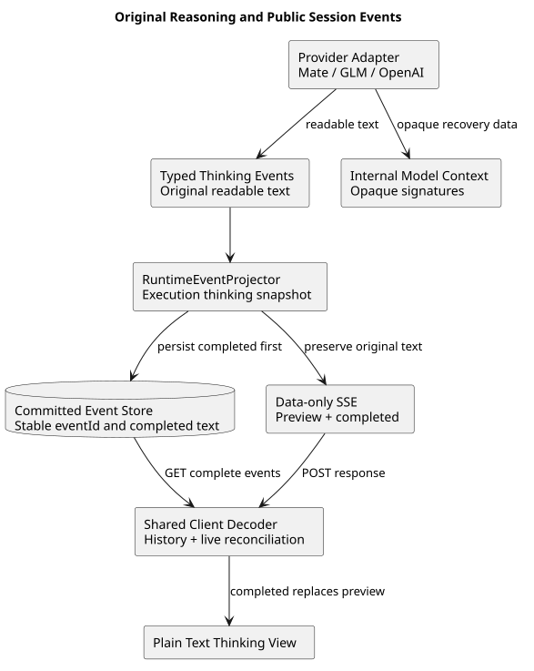

# 原始推理与公共事件边界

| 属性 | 值 |
|---|---|
| 版本 | 0.2.0 |
| 日期 | 2026-09-09 |
| Java 分析基线 | `af858b85ad2a5d2894360ce64accfdbe33d1418c` |
| 设计基线 | `pi-mono-java-design@81a9d6617ff56188bae9008d22d150fa7e5b61bf` |
| pi 源码基线 | `5cd93f688aaab89dbb6dfa4aca535f21796ae185` |
| 范围 | Thinking 原文、事件解码、工具确认归属与 Events 命名；实现随本变更交付 |

## 当前设计与理由

**展示模型返回的原始推理。** 执行快照启用 Thinking 且模型返回可读文本时，将文字、空格、换行和
片段顺序保留到 `agent.thinking`。CampusClaw 不生成摘要，也不要求 Provider 提供公开摘要标记。
该行为是产品约束；Provider 类型化适配、公共事件身份、授权和内部恢复数据仍各有边界。

delta 是临时预览，completed 保存一次并使用同一个 eventId；GET 返回相同的完整记录。
关闭 Thinking 影响后续执行，不隐藏已保存原文。没有文本的签名和加密载荷留在内部模型上下文。
前端使用纯文本显示原文，不将其中的 HTML 或 Markdown 作为可执行内容。

公共协议只校验事件外层与 arguments 的对象类型。模型可能生成不符合工具 Schema 的参数，
这些调用仍必须出现在 SSE 和历史中；工具执行层负责拒绝执行并产生失败结果。
CallMateTool 保留 `{tool,args}` 包装，缺省 args 补 `{}`，不凭空修复缺失 tool 或非法业务参数。

工具结果用 `sourceEventId + toolCallId` 关联。确认回执没有 sourceEventId，客户端按提交顺序在
对应 tool_call 之后、下一条 user.message 之前匹配；表单实例以 eventId 标识。
不同根消息复用 Provider toolCallId 时，旧确认和旧结果不能解除新调用的确认状态。

拒绝说明的 Runtime 契约上限是 4096 UTF-16 单元；前端读取 SSE/历史按此解码。
Composer 的 2048 Unicode code point 输入限制是界面产品约束，不能用它拒绝其他合法调用方的响应。

## 源码依据与实现差距

下列 Java 路径相对实现仓，观察对应上表基线；“本变更”列描述本分支实现。

| 基线源码 / 符号 | 观察 | 本变更与理由 |
|---|---|---|
| `modules/ai/src/main/java/com/campusclaw/ai/provider/mate/MateChatSseParser.java#appendReasoningText/#finishThinking` | 已将 GLM 等提供商的可读推理转换为默认 Thinking 事件 | 保留原文解析，无需 Provider 新增字段 |
| `modules/ai/src/main/java/com/campusclaw/ai/stream/AssistantMessageEvent.java` · Thinking 记录 | `publicSummary` 默认 false | 删除字段和来源门禁，恢复默认构造事件的展示能力 |
| `modules/ai/src/main/java/com/campusclaw/ai/provider/openai/OpenAIResponsesProvider.java#applyThinkingDelta/#handleOutputItemDone` | SDK 的 reasoning summary 文本进入 Thinking，并附加来源标记 | 保留 Provider 实际返回的文本，移除 CampusClaw 标记；SDK 原有协议名称不变 |
| `modules/coding-agent-cli/src/main/java/com/campusclaw/codingagent/runtimeapi/event/RuntimeV2EventProjector.java#projectThinking/#persistThinking` | 标记为 false 的 Mate 事件被过滤 | 当前类名为 RuntimeEventProjector；按执行快照与非空文本投影 |
| 同目录 `RuntimeCommittedEventFactory.java#publicToolArguments`；`modules/agent-core/src/main/java/com/campusclaw/agent/tool/ToolExecutionPipeline.java#validate` | 工具参数先进入调用事件，业务校验失败形成工具结果 | 客户端保留失败调用，不能把它当坏帧 |
| `frontend/src/runtime/protocol.ts#decodeEvent` | CallMateTool 内层 Schema 与输入长度校验误用于读取 | 事件结构校验与工具业务校验分层，响应长度使用 Runtime 上限 |
| `frontend/src/runtime/eventStore.ts#executionState`；`frontend/src/projectors/runtimeEventProjector.ts#projectRuntimeEvents` | 在整个 Session 中只按 toolCallId 寻找结果或确认 | 按根消息及调用后的提交顺序关联，避免跨轮干扰 |
| `modules/common/src/main/java/com/campusclaw/common/constant/ClawConstants.java` · RuntimeApi | denyMessage 上限 4096 UTF-16 单元 | 客户端读取沿用相同单位，保留更小的界面输入上限 |
| pi `packages/ai/src/types.ts` · ThinkingContent/AssistantMessageEvent；`packages/agent/src/agent-loop.ts#streamAssistantResponse` | 文本与 signature 分离，Thinking start/delta/end 进入 message_update，不要求公开摘要标记 | 保持内核生命周期；公共 HTTP 身份与持久化是 CampusClaw 架构变化 |

## 架构与命名

[PlantUML 源码](diagram.puml#L1) · [原尺寸](public_stream_support.svg)

Provider 负责原始 SSE 到领域事件，RuntimeEventProjector 负责公共投影；完整记录先持久化再输出。
RuntimeSseEmitterSubscriber 的生产入口使用 data-only SSE，心跳为 `: ping\n\n`。
观察断开不自动重发写请求；客户端读取历史进行对账。

当前只有一套 Session Events 契约，内部类按职责命名。RuntimeV2EventService、RuntimeV2MessageEventService、
RuntimeV2ControlEventService、RuntimeV2ExecutionCoordinator、RuntimeV2EventProjector、
RuntimeV2EventProjectorFactory 和 RuntimeV2EventEncoder 去掉 V2。
原压缩专用 RuntimeEventProjector/Factory 命名为 RuntimeCompactionEventProjector/Factory；
内部模型上下文查询 RuntimeEventQueryService 命名为 RuntimeContextHistoryService，避免与公共历史混淆。
HTTP 仍使用 `/campusclaw-service/v1`，此处命名调整不创建新的 HTTP 版本或兼容别名。

## 边界、性能与验收

- 不新增 Maven/npm 依赖、表、后台线程或版本兼容层；数据仍通过既有容量限制与有界输出队列。
- 工具错误仍由 ToolExecutionPipeline 校验并拒绝执行；放宽的是读取业务失败事件的能力。
- 验证原文空白和 HTML 样文本、预览与完整事件同一身份、完整事件与历史同形、关闭开关和仅签名无正文。
- 验证不合法 CallMateTool 参数可读、跨根消息同名 toolCallId 再次确认、4096 UTF-16 边界及 emoji 单位。
- 执行 `./mvnw clean verify`、前端测试与构建、镜像生成与一致性、PlantUML 和链接校验。
- 企业 NativeParent 未能在本机解析，企业镜像编译未验证；单元与 fixture 验证不替代真实 GLM、Mate 和企业数据库联调。

设计取舍见 [ADR-0104](../../decisions/0104-original-reasoning-and-event-contract.html)。

## 版本历史

| 版本 | 日期 | 变更 |
|---|---|---|
| 0.2.0 | 2026-09-09 | 展示原始推理，修正事件读取与确认归属，统一 Session Events 命名。 |
| 0.1.1 | 2026-09-08 | 规范 Mate 工具结果文本与 SSE 输出校验。 |
| 0.1.0 | 2026-09-08 | 增加 data-only SSE 编码。 |
