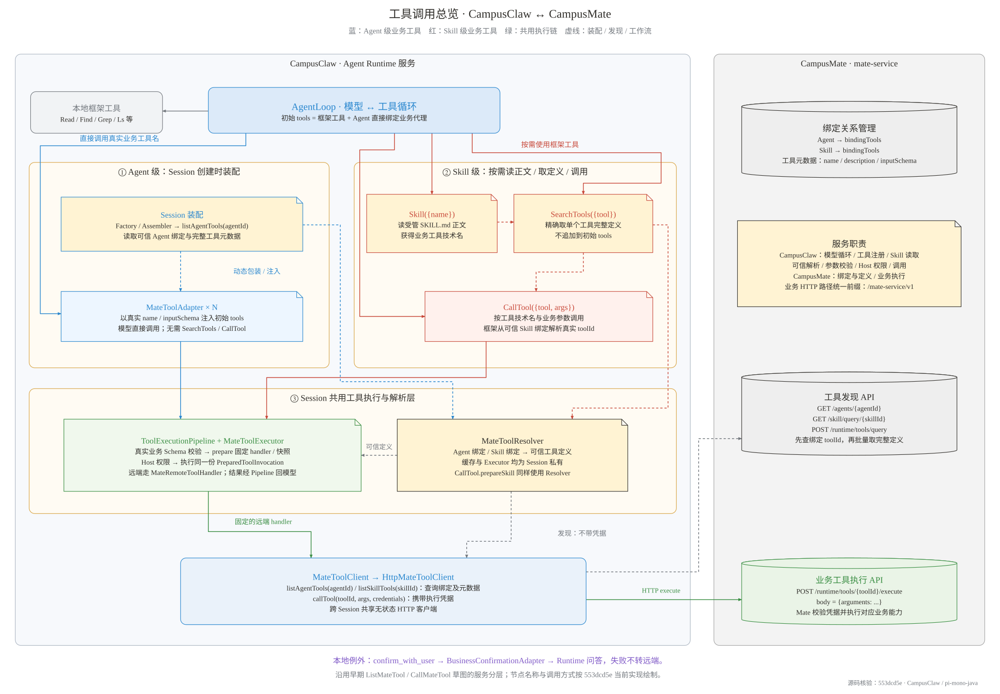
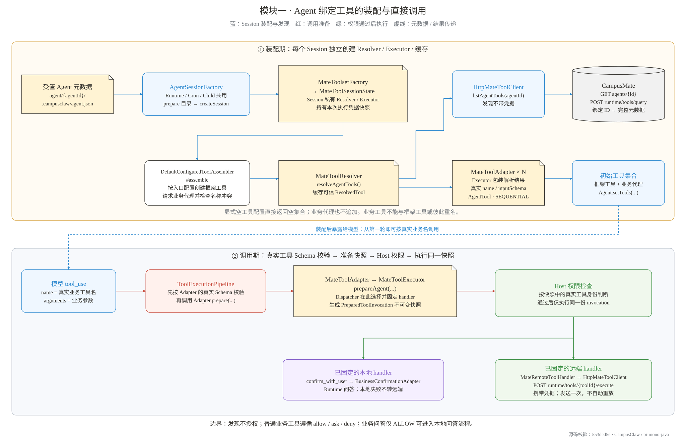
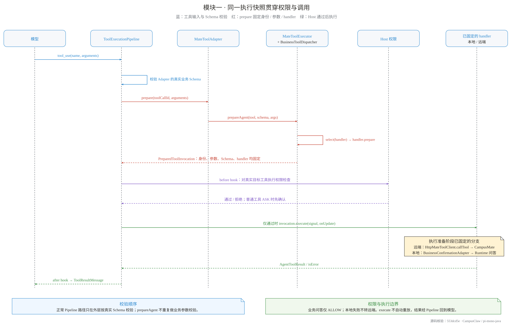
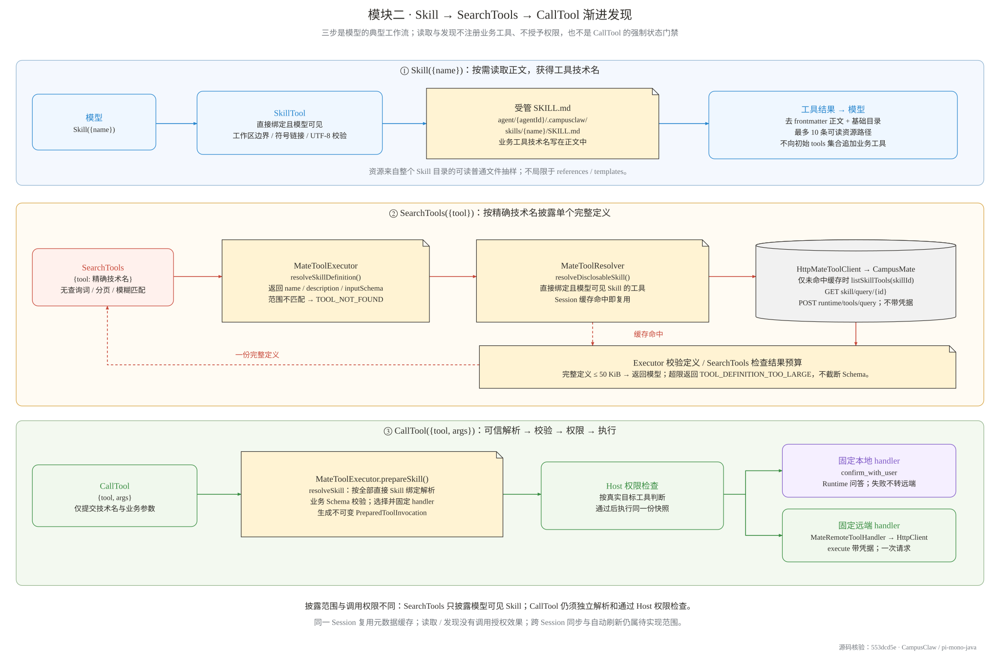
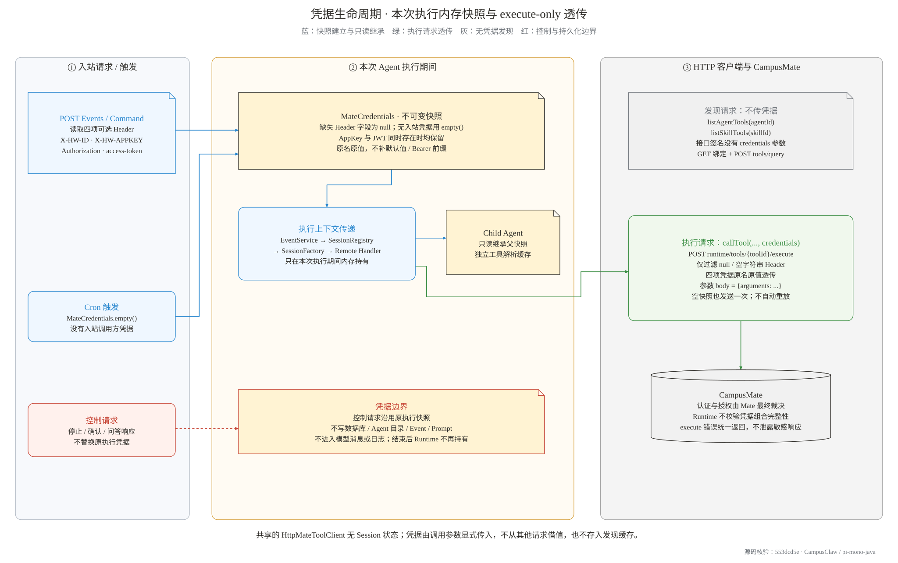

# 工具服务 Client 实现与架构

> 文档类型：实现与架构分析（面向评审/汇报）
>
> 状态：对齐 upstream/main 现状
>
> 日期：2026-10-08
>
> 源码基线：`upstream/main @ 553dcd5e`（含 PR #323 渐进发现、PR #327 工具权限）
>
> 精确发现核验提交：`8e4d9914`；凭据规则核验提交：`db990ab3`
>
> 作者：TestCat
>
> 关联文档：[Mate 工具设计（权威契约）](mate-tool-client.md)、[工具系统 v2](tool-system-v2.md)、
> [ADR-0022](../decisions/0022-managed-agent-tool-system-v2.html)、
> [ADR-0024](../decisions/0024-mate-tool-execution-credential-chain.html)、
> [ADR-0032](../decisions/0032-tool-execution-credential-boundary.html)、
> [ADR-0026](../decisions/0026-unify-campusmate-client-configuration.html)

---

## 1. 背景

远程业务工具的绑定、定义与执行由 **CampusMate 工具服务**（`mate-service`）提供，
CampusClaw 负责 Agent 运行与调用框架；已绑定的 `confirm_with_user` 由 CampusClaw 适配为本地问答。
工具服务 Client
指的就是 CampusClaw 侧负责和这个服务打交道的整条代码链路，它要做四件事：查明一个 Agent
能用哪些业务工具（发现）、把这些工具以合适的形式呈现给模型（注册）、真正发起一次远程调用
（执行），以及管好凭据、权限和失败时的行为（边界）。

业务工具按"绑定在哪里"分成两类，两类走完全不同的暴露路径，本文就按这两个模块展开：

| 模块 | 绑定位置 | 暴露方式 | 模型如何调用 |
|---|---|---|---|
| **模块一** | Agent 元数据（工具直接绑在 Agent 上） | Session 创建时动态加载，包装成 `AgentTool` 注入初始工具集合 | 像调本地工具一样直接调用 |
| **模块二** | Skill 元数据（工具只绑在 Skill 上） | 不预注入；模型先调 `Skill` 工具读到工具名 | `SearchTools` 取定义 → `CallTool` 调用 |

### 1.1 两类业务工具与服务边界



[查看高清 PNG](tool-service-client-architecture/service-overview.png) ·
[可编辑源文件：draw.io（共 5 页）](tool-service-client-architecture/tool-service-client.drawio) ·
[配图生成脚本](tool-service-client-architecture/render_diagrams.py)

图中左侧是 **CampusClaw**：AgentLoop 驱动模型与工具循环，Agent 级工具由 Session 装配成
`MateToolAdapter`，Skill 级工具经 `Skill`、`SearchTools`、`CallTool` 按需使用。两条调用路径
共用 Session 内的可信解析、执行准备和 Host 权限链，最终由 CampusClaw 内部的
`MateToolClient` / `HttpMateToolClient` 跨服务发起 HTTP 请求。右侧 **CampusMate** 管理
Agent / Skill 的工具绑定、完整工具定义和远程业务执行。`confirm_with_user` 是本地问答例外，
不进入远程执行链。

这张图沿用早期 `ListMateTool` / `CallMateTool` 草图的服务分层，名称和行为对齐本文源码基线。
历史批量列表发现已由“`Skill` 读取工具名 + `SearchTools` 精确取单个定义”承接；历史调用入口
则分成 Agent 业务原名代理和 Skill 的 `CallTool`，不能把两条路径都画成 `CallTool`。
虚线表示装配、发现或模型工作流，不表示调用授权，也不表示必须先发现才能调用。

### 1.2 框架工具配置

模块二依赖的三个框架工具在 `BuiltInToolName`（12 个工具的闭合枚举）中的位置如下。
配置列表会整体替换缺省值；显式空数组表示该入口一个工具都没有，也不会追加任何业务工具。

```yaml
campusclaw:
  tools:
    runtime:     [Read, Find, Grep, Ls, Cron, Skill, SearchTools, CallTool, Agent, ExitPlanMode, TodoUpdate, AskUserQuestion]
    cron:        [Read, Find, Grep, Ls, Skill, SearchTools, CallTool, Agent]
    child-agent: [Read, Find, Grep, Ls, Skill, SearchTools, CallTool]
```

---

## 2. 模块一：Agent 元数据定义的工具（动态加载注入）

管理员在 Mate 侧把某些业务工具直接绑定到 Agent 上，这层绑定关系最终会落到 Agent 的受管
目录（`agent/{agentId}/.campusclaw/agent.json`）。模块一做的事是：**当某个 Session 被创建时，
把这些绑定的工具查出来，包装成和本地工具一模一样的 `AgentTool` 实例塞进模型的初始工具集合**。
这样模型从第一轮对话起就能看到这些工具的真实名字和参数定义，调用时不需要任何"发现"动作。

### 2.1 工具调用框架

上半部分是装配期（Session 创建时发生一次），下半部分是调用期（模型每轮对话都可能发生）：



[查看高清 PNG](tool-service-client-architecture/agent-tools.png)

### 2.2 装配期具体做了什么

整个流程从 `AgentSessionFactory` 开始。无论是 HTTP 请求、Cron 定时触发还是子 Agent 执行，
三种入口都走同一个工厂创建 Session。工厂先 `prepare` 受管目录（缓存命中则直接复用），然后把
`PreparedAgentRuntime` 和本次执行的凭据快照交给 `MateToolsetFactory.createSession(...)`，
后者 new 出一个 `MateToolResolver` 和一个 `MateToolExecutor`，包成 `MateToolSessionState`。
这三样东西都是 **Session 私有**的——两个 Session 互不共享缓存和状态；真正跨 Session 共享的
只有 `HttpMateToolClient`，它是无状态的 HTTP 客户端。

接着 `DefaultConfiguredToolAssembler#assemble` 被调用。它先按入口配置（runtime/cron/child）
创建框架工具，然后调用 `mateToolSessionState.createAgentToolAdapters()`。这个方法内部就是
`MateToolResolver#resolveAgentTools()`：Resolver 向 `HttpMateToolClient` 发起发现请求，分两步走——
第一步请求 `GET /mate-service/v1/agents/{agentId}`，从返回的 `bindingTools` 数组里按顺序取出
`toolId` 列表（这个顺序就是 Mate 侧的绑定顺序）；第二步把这份 ID 列表整体发给
`POST /mate-service/v1/runtime/tools/query`，拿回每个工具的完整元数据（name、description、
inputSchema）。HTTP 客户端按请求 ID 的顺序关联元数据，Resolver 再按可信绑定解析并缓存
`ResolvedTool`；这里不承诺最终 Adapter 列表仍保持绑定顺序。元数据存在重复 ID，或缺少请求的
ID 时直接失败；返回的额外 ID 不参与解析。同一个技术名绑定到不同 ID 时也直接失败，避免调用目标歧义。

### 2.3 注册：包装成 `MateToolAdapter` 注入

拿到 `List<ResolvedTool>` 之后，每一条都会被包装成一个 `MateToolAdapter`。这个类实现了
agent-core 的 `AgentTool` 接口，所以对工具执行框架来说，它和一个本地工具没有任何区别——
框架不需要知道"这个工具其实是个远程代理"。Adapter 的各个属性直接来自解析结果：

| Adapter 属性 | 来源 |
|---|---|
| `name()` | 可信绑定的技术名（模型看到并用于调用的名字） |
| `label()` | 绑定的显示名，为空时回退技术名 |
| `description()` | Mate 元数据里的工具描述 |
| `parameters()` | Mate 元数据里的 `inputSchema`（真实业务参数定义） |
| `executionMode()` | 固定 `SEQUENTIAL`——业务工具通常有副作用，不做并行批次 |

`DefaultConfiguredToolAssembler` 把这些 Adapter 追加到框架工具后面，追加前做两道校验：
整个集合里名字不能重复；业务工具的名字不能和任何框架工具撞名（否则模型无法区分调用目标），
撞名直接让启动失败。最终这份工具列表进入发给模型的 `tools` 参数——也就是说，业务工具走的是
模型 API 原生的工具调用机制，模型是"看见工具然后调用"，而不是从对话历史里读到工具列表再去猜。

### 2.4 调用时序



[查看高清 PNG](tool-service-client-architecture/invocation-sequence.png)

模型的 `tool_use` 到达后，`ToolExecutionPipeline` 先用 Adapter 自带的 `parameters()`
（即真实业务 Schema）校验参数，这一步在框架层就把明显不合法的调用拦下来了。通过后框架调
`Adapter.prepare(...)`，Adapter 把调用连同解析结果转给 `MateToolExecutor.prepareAgent`。
正常 Pipeline 路径不重复校验业务参数；Executor 在 prepare 阶段选择并固定处理器，生成
`PreparedToolInvocation` 不可变快照，固定调用 ID、参数深拷贝、目标工具身份、Schema 与处理器。
关键在于时序：**校验、处理器选择和快照都发生在权限检查之前**，所以 Host 在做 allow/ask/deny 判断、
以及在需要时向用户弹确认时，看到的已经是"解析出的那个真实工具"和"校验过的参数"，
而不是一个空壳调用。确认通过后，框架执行的是同一份快照，任何中间步骤都不会偷换参数。

---

## 3. 模块二：Skill 元数据定义的工具（渐进发现）

只绑定在 Skill 上的业务工具**不进初始工具集合**。原因是显而易见的：一个 Agent 可能挂很多
Skill，每个 Skill 又可能关联若干工具，全部预注入会把上下文撑爆，而且模型面对一堆当下用不上
的工具反而容易误选。模块二改成"用到哪个 Skill 才看哪个 Skill"：模型先调 `Skill` 工具读正文，
正文里写着这个 Skill 关联了哪些业务工具（技术名）；模型需要某个工具的定义时调 `SearchTools`
精确取一份；确定怎么传参之后调 `CallTool` 真正执行。三步都是框架工具，发现过程本身不往模型
工具集合里加任何东西，也不授予任何调用权限。

### 3.1 工具调用框架

图中是模型的典型渐进工作流。三步之间没有强制状态门禁：已知工具技术名与参数时，
`CallTool` 仍会独立解析可信绑定、校验参数并经过 Host 权限判断。



[查看高清 PNG](tool-service-client-architecture/skill-tools.png)

### 3.2 第一步：`Skill({name})` 读到工具名

模型在系统提示词里只能看到 Skill 的名称和一句话描述，看不到内容。当模型判断某个 Skill
和当前任务相关时，就调用 `Skill({name})`。SkillTool 拿到名字后先做安全检查：这个名字必须
对应当前 Agent 直接绑定、模型可见且在 `agent/{agentId}/.campusclaw/skills/{name}/` 下
真实存在的 Skill；读取路径经过工作区边界校验（拒绝符号链接、
拒绝逃出 Agent 根目录），文件必须能按 UTF-8 解码成文本。通过后读取 `SKILL.md`，去掉头部的
YAML frontmatter，把正文、该 Skill 的基础目录和最多 10 条抽样资源路径一起作为工具结果返回。
抽样范围是整个 Skill 目录内的可读普通文件，排除 SKILL.md 和 manifest，不限于 references/templates。
正文缺失、不可读、是目录或者是符号链接，都走统一的
工具错误路径返回失败，不会静默给个空结果。

关键是：**业务工具的技术名就写在正文里**。Skill 作者维护 SKILL.md 时会直接写"本 Skill 提供
`xxx_yyy` 工具，用于……"。模型读完正文，就知道下一步该搜什么名字。

### 3.3 第二步：`SearchTools({tool})` 精确取定义

模型看到正文提到某个工具名，但还不知道它的参数怎么传，于是调用 `SearchTools({tool})`。
SearchTools 自身不做任何"搜索"——它不接收 Skill 名、查询词、limit 或分页参数，不做模糊匹配，
也不会去猜 Markdown 里可能的名字。它只是把参数里的名字原样交给 `MateToolExecutor`。

Executor 先查**披露范围**：这个名字必须出现在"当前 Agent 直接绑定、且对模型可见的那个 Skill"
所关联的工具里（`resolveDisclosableSkill`）。不在范围内就直接返回 NOT_FOUND——包括那些确实
存在、但挂在模型看不见的 Skill 下的工具，也不泄露它们的存在。范围内命中后，Resolver 查
Session 缓存，缓存没有才向 Mate 发起按需查询（`listSkillTools`，两段式：先 `GET skill/query/{id}`
取绑定的 toolId 列表，再 `POST tools/query` 批量拿元数据）。拿到定义后还要过两道关：这份定义
的 JSON Schema 本身由 Executor 校验（`validateDefinition`）；SearchTools 检查序列化文本的
结果预算（`MAX_DEFINITION_RESULT_BYTES`，50 KiB），超了就返回 `TOOL_DEFINITION_TOO_LARGE`，不截断 Schema——
半份 Schema 比没有更危险。都通过后，把这一个工具的完整 `name/description/inputSchema`
作为结果返回给模型。

### 3.4 第三步：`CallTool({tool,args})` 按名调用

模型拿到定义后，按定义构造参数调用 `CallTool({tool, args})`。它的外层参数结构非常薄：
只有 `tool`（精确技术名）和 `args`（缺省空对象），模型不需要也不能提交 scope、Skill、toolId
或 URL——这些全部由框架根据解析结果决定。`prepareSkill` 先在全部直接 Skill 绑定中按名解析
可信工具，这一执行解析范围不同于 `SearchTools` 的模型可见披露范围。若发现阶段已建立缓存，
这里复用同一份定义；否则按需解析。Executor 进行业务 Schema 校验，在 prepare 阶段选择处理器
并生成不可变快照，Host 按真实工具做权限检查和必要确认，最后执行同一快照。实际 execute
请求只发送一次，超时、断线、业务失败都不自动重试。解析失败后可重新解析，但当前实现没有
自动解析重试循环。

### 3.5 为什么解析和缓存是 Session 私有的

模块二有两个容易被忽略的设计点。第一，`resolveSkill` 是**按需**查询的：调用某个 Skill 的
工具时只查这一个 Skill 的绑定，而不是把"整个 Agent 加全部 Skill"刷新一遍作为前置条件——
一次调用不该为它用不到的数据付出全量网络成本。第二，解析结果缓存在 Session 里，这保证了
同一次执行中 `SearchTools` 返回的定义和 `CallTool` 校验用的定义必然是同一份，不会出现
"搜索时一个样、调用时另一个样"的漂移。代价是缓存不跨请求同步：Mate 侧改了工具定义，正在
执行的 Session 感知不到，这属于后续"同步/刷新"要解决的待实现范围。

---

## 4. 两模块共用的执行语义

两条路径在外层入口不同：Agent 代理由 Pipeline 按真实 Schema 校验；Skill 的 `CallTool`
在 Executor 的 `prepareSkill` 中解析并校验业务参数。两者随后共用执行准备与固定处理器。
一次调用的固定顺序是：**可信解析 → 业务参数校验 → 固定处理器和快照 → 权限/必要确认 → 业务执行
→ 结果回传**。校验被刻意安排在权限之前，这让 Host 的授权判断和用户确认建立在"已知工具身份、
已知合法参数"之上，而不是先授权再看参数。

校验通过后生成的 `PreparedToolInvocation` 是不可变的：调用 ID、参数深拷贝、目标工具的
名字/ID/版本、inputSchema 和处理器都固定在快照里。确认通过后执行的就是这份快照，中间不存在
"确认的是 A、执行的是 B"的窗口。如果参数校验失败，返回给模型的错误是真实的
`isError=true`，并附上字段级错误信息和本次校验用的完整可信定义——模型可以读懂错在哪、
按定义修正后**发起新的调用**。这和"重放"是两回事：重放是框架偷偷把旧调用再发一遍，
修正重调是模型主动行为。附带一条恢复预算规则：错误结果里的定义全文超预算时，只有当该工具
属于 `SearchTools` 可披露范围、且单个定义能独立放进预算时，才提示模型按名取定义，否则只说明
定义无法返回。

准备阶段由 `BusinessToolDispatcher` 按可信工具名选择处理器。绝大多数业务工具走
`MateRemoteToolHandler` 远调 Mate；唯一例外是已绑定的 `confirm_with_user`，它在本地由
`BusinessConfirmationAdapter` 处理——只做 label/context/content 的格式转换，接入 Runtime
的通用问答流程，**本地失败也不会降级成远端调用**。业务问答只在 Runtime 入口具有 QuestionPort
且权限为 ALLOW 时进入本地流程。处理器选择随快照固定，权限通过后不会重新分发。

---

## 5. HTTP 层：`MateToolClient` / `HttpMateToolClient`

`MateToolClient` 是两个模块共用的接口，只有三个方法。前两个是发现（模块一查 Agent 绑定、
模块二查 Skill 绑定），注意它们的签名里根本没有凭据参数——发现请求天然不携带凭据；第三个是
执行，凭据作为显式参数传入：

```java
public interface MateToolClient {
    List<MateToolMeta> listAgentTools(String agentId);        // 模块一发现，不带凭据
    List<MateToolMeta> listSkillTools(String skillId);        // 模块二发现，不带凭据
    ToolResult callTool(String toolId, Map<String,Object> args, MateCredentials credentials);  // 两模块执行
    record ToolResult(String content, Map<String,Object> metadata, boolean isError) {}
}
```

所有端点都从 `campusmate.*` 配置读取，和 Model 客户端、受管 Runtime 共享同一个 base-url：

| 配置键 | 缺省值 |
|---|---|
| `campusmate.base-url` | `${CAMPUSMATE_BASE_URL}` |
| `campusmate.endpoints.agent-info-path-template` | `/mate-service/v1/agents/%s` |
| `campusmate.endpoints.skill-info-path-template` | `/mate-service/v1/skill/query/%s`（与受管 Runtime 共用） |
| `campusmate.endpoints.tool-metadata-query-path` | `/mate-service/v1/runtime/tools/query` |
| `campusmate.endpoints.tool-execute-path-template` | `/mate-service/v1/runtime/tools/%s/execute` |

失败语义在两个方向上做了区分。发现请求失败会包装成带 operation 定位的公开异常向上抛，
调用方（装配或解析）据此失败；但**执行**请求的任何异常——网络、构造、解析——都会被
`callTool` 收敛成同一句 `ToolResult("Mate tool execution request failed", isError=true)`。
统一文本是刻意的：Mate 的业务错误消息 `resMsg` 或畸形响应正文里可能包含敏感内容，
不应该原样回显给模型。网络层 `MateRestUtil` 同样只省略 null 或空字符串的 Header，
捕获到可能含 Header 值或响应正文的异常时，不保留原始 message 和 cause，
只保留非敏感的定位信息和来源栈帧。

---

## 6. 凭据链

执行凭据用 `MateCredentials` 表示，是不可变的四项快照：`X-HW-ID`、`X-HW-APPKEY`、
`Authorization`、`access-token`。它的 `toString()` 只显示每个字段"是否存在"，不输出值；
AppKey 和 JWT 两种身份凭据同时出现时原样都发，由 Mate 裁决，Runtime 不做取舍。



[查看高清 PNG](tool-service-client-architecture/credential-lifecycle.png)

完整生命周期是这样流转的：调用方（HTTP Runtime 或 Command 入口）在接受执行请求时读取这
四个 Header，建立不可变快照——缺哪个就记 null。无入站凭据的 Cron 等路径使用
`MateCredentials.empty()`；传入凭据对象为 null 时也会归一化为空快照。这份快照只在
**本次 Agent 执行期间**存在于内存里，沿着 EventService → SessionRegistry → SessionFactory
传递给执行栈；子 Agent 只读继承父级的快照，而停止、确认、问答这类控制请求不允许替换原值。
它不写数据库、不进 Agent 目录、不出现在 Event、Prompt、模型消息或日志里，执行结束后
Runtime 不再持有。真正使用它的地方只有一处：代理工具或 `CallTool` 最终发起
`POST .../tools/{toolId}/execute` 时，把快照里**非空**的值按原名放进同名 Header。
发送规则是"透传"而不是"补全"——不补默认值、不加 Bearer 前缀、不从别的请求借值，
也不校验组合或最低完整性：哪怕四项全空，只要工具合法、权限通过且未取消，这个请求照样发出
一次（Cron 没有入站调用方，空快照同样照发），认证和授权的最终裁决权在 Mate。

---

## 7. 错误处理与稳定错误码

所有业务工具相关的失败都收敛到一组稳定错误码，随 `ToolResultMessage(isError=true)` 进入
公共事件流，前端和调用方可以按码处理而不用解析文案：

| 场景 | 稳定错误码（`ClawConstants.RuntimeApi`） |
|---|---|
| 名称未绑定或不可披露 | `TOOL_NOT_FOUND` |
| 同名工具绑定到不同 ID | `TOOL_DEFINITION_CONFLICT` |
| 元数据缺失、绑定无效、Schema 不可用 | `TOOL_DEFINITION_UNAVAILABLE` |
| 定义 JSON Schema 本身非法 | `TOOL_DEFINITION_INVALID` |
| 完整定义超出结果预算 | `TOOL_DEFINITION_TOO_LARGE` |

日志和对外文案也是分开的。无效 Schema 这类底层异常由 `MateToolExecutor` 在日志里记录一次
完整上下文（operation、errorCode、toolId、原始异常），但返回给模型的只有稳定失败文本——
不带 cause、不带调用参数、更不带凭据。

---

## 8. 边界情况

| 场景 | 行为 |
|---|---|
| 业务工具与框架工具重名 | 装配期启动失败（两模块都受保护） |
| Session 内同名工具绑定到不同 ID | 解析期原子失败（CONFLICT） |
| `SearchTools` 查询不可披露 Skill 的工具 | `TOOL_NOT_FOUND`，不泄露存在性 |
| Skill 正文引用了不存在的工具名 | `SearchTools` 返回 NOT_FOUND，模型可停止或换路径 |
| 同一工具既绑 Agent 又绑 Skill | 保留 Agent 直接代理（模块一优先） |
| 完整定义超预算 | 不截断、不提示重复查询；恢复提示仅在单定义可独立放入预算时给出 |
| execute 期间取消 | 执行前检查 `CancellationToken`，取消即中断 |
| Cron 无入站凭据 | 发现正常；execute 照发（空快照），由 Mate 校验失败 |
| 业务确认（confirm_with_user）本地失败 | 不降级远调，适配器不维护第二份 prepared 状态 |
| 缓存与远端漂移 | Session 内复用同一解析缓存；跨请求同步属待实现 |

---

## 9. 实现状态

| 范围 | 状态 |
|---|---|
| 模块一：Agent 直接工具动态加载与代理注入 | ✅ 已实现 |
| 模块二：Skill 渐进发现（Skill/SearchTools/CallTool）与精确调用 | ✅ 已实现（`8e4d9914`） |
| 确认前业务参数校验、恢复预算、前端参数错误状态 | ✅ 已实现 |
| 凭据四项读取、执行期内存持有、execute-only 透传、日志脱敏 | ✅ 已实现（`db990ab3`，129 项聚焦测试通过 2026-09-19） |
| 数据来源接入、加载策略、同步、刷新、失效 | ⏳ 待实现 |
| 跨节点一致性、工具版本切换 | ⏳ 待实现 |

---

## 10. 参考

- `modules/coding-agent-cli/src/main/java/com/campusclaw/codingagent/tool/mate/`——Session 侧全部实现：
  - 模块一：`MateToolAdapter`、`MateToolExecutor#createAgentToolAdapters/prepareAgent`；
  - 模块二：`SkillTool`、`SearchTools`、`CallTool`、`MateToolExecutor#prepareSkill/resolveSkillDefinition`；
- `tool/builtin/DefaultConfiguredToolAssembler.java`——模块一注入点；
- `common/client/`——HTTP 客户端与凭据（`MateToolClient`/`HttpMateToolClient`/`MateCredentials`）；
- `modules/agent-core/.../tool/PreparedToolInvocation.java`、`ToolSchemaValidator.java`——两段式与校验；
- `docs/designs/mate-tool-client.md`（权威契约 v3.2.0）、`docs/designs/tool-system-v2.md` §7。
